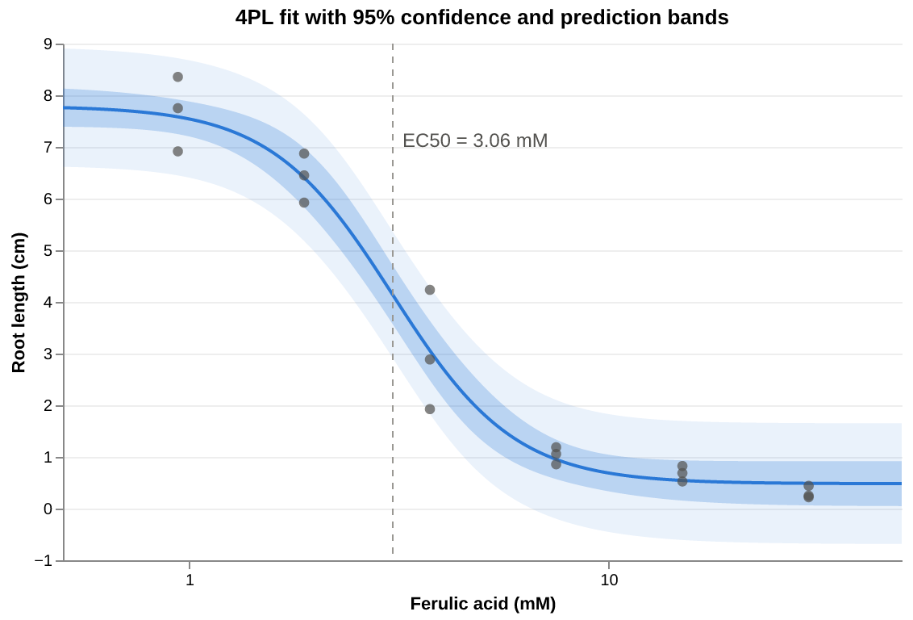
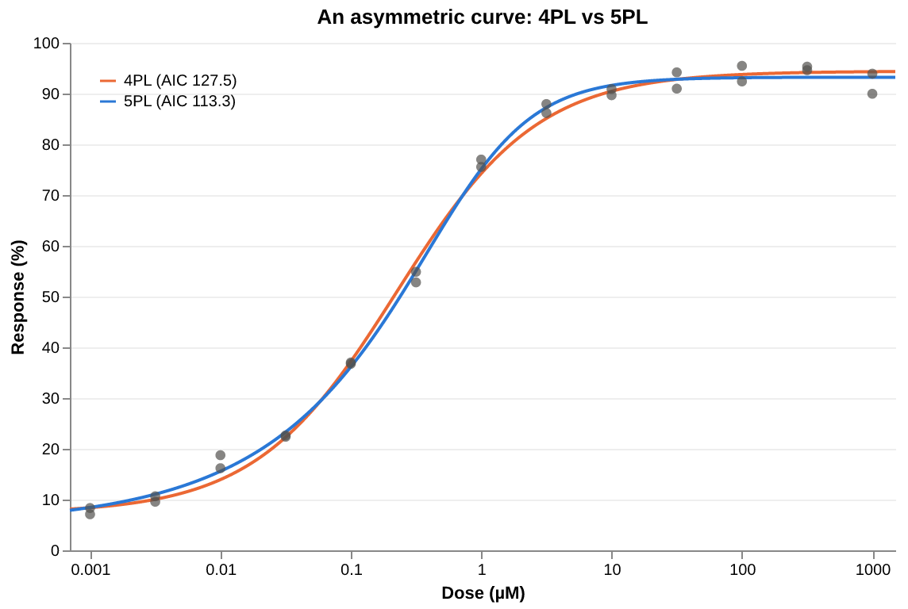
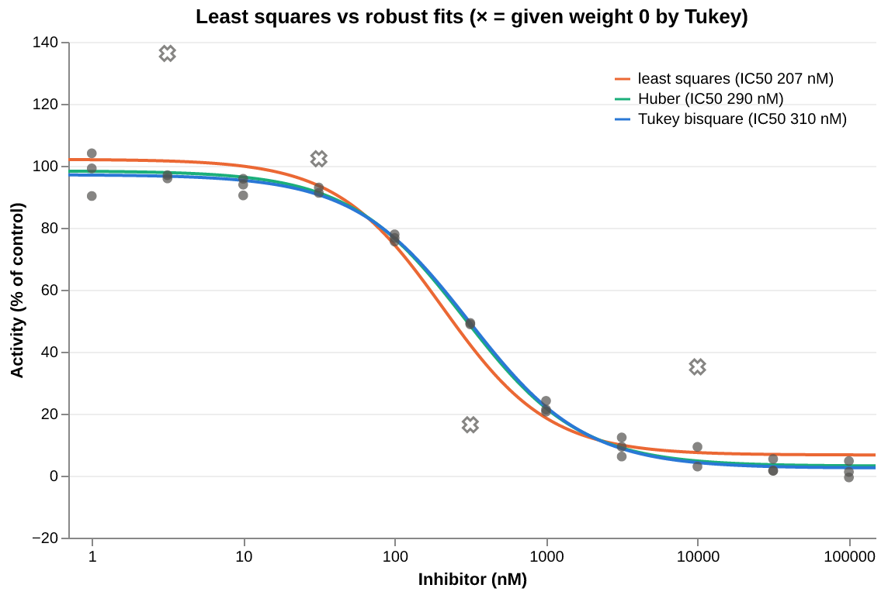
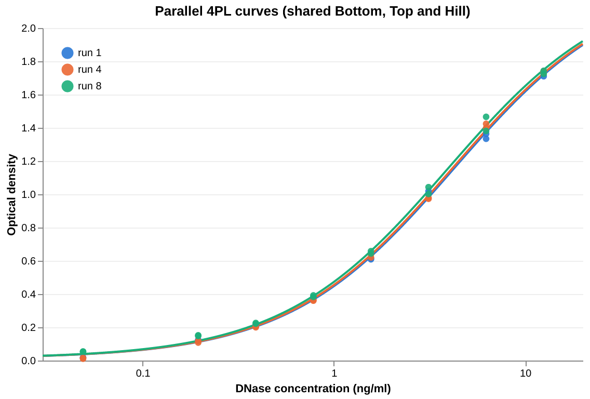

# drc

Dose-response curve fitting for Nim, with no dependencies beyond the standard library.

- Three-, four- and five-parameter logistic fits (3PL, 4PL / Hill, 5PL)
- Levenberg–Marquardt with multi-start, and a Nelder–Mead fallback
- Zero-dose controls, fixed or bounded parameters and weighted fits
- Robust fits (Huber, Tukey bisquare) that downweight or reject outliers
- Standard errors, t-based (Wald or profile-likelihood) and bootstrap confidence intervals, R², AIC/BIC, residuals and a lack-of-fit test
- EC50 and any ECx (EC10, EC90, …), relative or absolute, with confidence intervals
- Inverse prediction: doses read off a standard curve, with calibration intervals
- Confidence and prediction bands for the fitted curve
- Joint fits of several curves with shared parameters (e.g. parallel curves),
  relative potency with confidence intervals, and F tests between nested fits
- Results validated against R (`nls`, `robustbase::nlrob`, and the published `drc` estimates for its `ryegrass` dataset)

## Installation

Requires Nim ≥ 2.0. From a clone of this repository:

```sh
nimble install    # or: nimble develop
nimble test       # run the test suite
nimble figures    # re-render the README figures (needs nim-plotter and vl-convert)
```

## The models

Responses are fitted against x = log10(dose) with the five-parameter logistic:

```
f(x) = Bottom + (Top − Bottom) / (1 + 10^((LogEC50 − x) · Hill))^Asymmetry
```

| Function | Model | Free parameters |
|---|---|---|
| `fitLL4` | 4PL (Hill equation) | Bottom, Top, LogEC50, Hill; Asymmetry is fixed at 1 |
| `fitLL3` | 3PL | as 4PL, with Bottom fixed (at 0 unless `fixed` gives it) |
| `fitLL5` | 5PL | all five, for curves that are not symmetric about their midpoint |

Each is `fitCurve` with the model given, so `fitCurve(LL5, doses, responses)`
is `fitLL5(doses, responses)`. Use `fitCurve` to choose the model at run time,
for example to compare `[LL4, LL5]` by AIC in a loop. All of them take the
same `weights`, `fixed`, `bounds` and `opts` arguments.

- **Hill > 0** gives a rising curve and **Hill < 0** a falling one (inhibition).
  Fits are reported with Bottom < Top.
- **A dose of 0** is treated as the low-dose plateau, so untreated controls can
  stay in the data.
- **`fit.params`** is indexed by `Bottom`, `Top`, `LogEC50`, `Hill` and `Asymmetry`.
- **In a 5PL, LogEC50 is a location parameter**, not the log of the half-way
  dose. Use `fit.ec50` and `fit.ecx(p)`, which give the actual doses for
  every model.

## Examples

### Fit a curve and print a summary

```nim
import drc

# Ryegrass root length vs ferulic acid concentration (mM), from the R drc package
let doses = [
  0.0, 0.0, 0.0, 0.0, 0.0, 0.0, 0.94, 0.94, 0.94, 1.88, 1.88, 1.88, 3.75, 3.75, 3.75,
  7.5, 7.5, 7.5, 15.0, 15.0, 15.0, 30.0, 30.0, 30.0,
]
let rootLength = [
  7.58, 8.0, 8.3285714, 7.25, 7.375, 7.9625, 8.3555556, 6.9142857, 7.75, 6.8714286,
  6.45, 5.9222222, 1.925, 2.8857143, 4.2333333, 1.1875, 0.8571429, 1.0571429, 0.6875,
  0.525, 0.825, 0.25, 0.22, 0.44,
]

let fit = fitLL4(doses, rootLength)
echo fit.summary
```

```
4PL fit to 24 observations

              Estimate   Std.Error     Lower 95%     Upper 95%
Bottom        0.481410    0.209506     0.0443880      0.918432
Top            7.79296    0.189733       7.39719       8.18874
LogEC50       0.485431   0.0263916      0.430379      0.540483
Hill          -2.98223    0.458429      -3.93849      -2.02596
EC50           3.05796                   2.69389       3.47123

Residual standard error: 0.519626 on 20 degrees of freedom
R²: 0.978252   AIC: 42.3103   BIC: 48.2006
Stopped after 7 iterations: relative change in SSR below ftol
```

The same fit with its 95% confidence and prediction bands (see below). The
untreated controls are in the fit but can't be drawn on a log axis:



### Normalised data with fixed plateaus

For responses normalised to controls, fix the plateaus at 0 and 100:

```nim
import std/strformat
import drc

let doses = [1e-9, 1e-8, 1e-7, 1e-6, 1e-5, 1e-4] # molar
let viability = [98.2, 95.1, 71.4, 22.9, 6.3, 2.0] # % of untreated control

let fit = fitLL4(doses, viability, fixed = [(Bottom, 0.0), (Top, 100.0)])
let ci = fit.ec50CI
echo &"IC50 = {fit.ec50 * 1e9:.1f} nM (95% CI {ci.lower * 1e9:.1f}–{ci.upper * 1e9:.1f} nM)"
echo &"Hill = {fit.params[Hill]:.2f} ± {fit.se[Hill]:.2f}"
```

```
IC50 = 272.8 nM (95% CI 227.9–326.5 nM)
Hill = -0.89 ± 0.04
```

Fixed parameters have a standard error of 0 and do not count towards the
degrees of freedom. A 3PL with only Bottom fixed is `fitLL3(doses, viability)`,
or `fitLL3(doses, viability, fixed = [(Bottom, 5.0)])` for a Bottom other than 0.

### Bounded parameters

Bounds keep a parameter within a range, but let the data place it there.
They suit partial curves, where an unconstrained plateau drifts past
what is physically possible:

```nim
import std/strformat
import drc

let doses = [1e-9, 1e-9, 1e-8, 1e-8, 1e-7, 1e-7, 1e-6, 1e-6, 1e-5, 1e-5] # molar
# % of control
let viability = [101.3, 97.8, 96.1, 99.0, 78.2, 74.9, 31.5, 36.0, 4.1, 1.2]

let free = fitLL4(doses, viability)
let fit =
  fitLL4(doses, viability, bounds = [(Bottom, 0.0 .. Inf), (Top, -Inf .. 100.0)])
echo &"unbounded: Bottom {free.params[Bottom]:.2f}, Top {free.params[Top]:.2f}, IC50 {free.ec50 * 1e9:.1f} nM"
echo &"bounded:   Bottom {fit.params[Bottom]:.2f}, Top {fit.params[Top]:.2f}, IC50 {fit.ec50 * 1e9:.1f} nM"
echo "at a bound: ", fit.atBound
echo fit.summary
```

```
unbounded: Bottom -7.59, Top 101.36, IC50 517.7 nM
bounded:   Bottom 0.00, Top 100.00, IC50 423.1 nM
at a bound: {Bottom, Top}
4PL fit to 10 observations

              Estimate   Std.Error     Lower 95%     Upper 95%
Bottom         0.00000     4.08586      -9.99773       9.99773  (at lower bound)
Top            100.000     2.10550       94.8480       105.152  (at upper bound)
LogEC50       -6.37355   0.0701354      -6.54517      -6.20194
Hill         -0.878916    0.105150      -1.13621     -0.621623
EC50       4.23106e-07               2.84993e-07   6.28152e-07

Residual standard error: 3.26504 on 6 degrees of freedom
R²: 0.995571   AIC: 56.9360   BIC: 58.4489
Stopped after 9 iterations: relative change in SSR below ftol
Warning: a parameter is at a bound; its standard error and interval ignore the bound
```

- **`bounds`** takes `(param, lower .. upper)` pairs, with `-Inf` or `Inf`
  for a one-sided bound. A parameter can be fixed or bounded, not both.
  `fitLL3`, `fitLL5`, the joint fits and robust fits all take `bounds`.
  In a joint fit, a bound applies to every curve.
- **A parameter that ends on a bound** is listed in `fit.atBound` and raises
  `fwAtBound`. It still counts as free in `df` and AIC, and its standard
  error is computed as if it were unbounded, as in R's
  `nls(algorithm = "port")` and SciPy's `curve_fit`. Its interval can
  therefore cross the bound, as Bottom's does here. A bound that binds also
  means the data alone would put the parameter elsewhere, so the other
  estimates (here the IC50) depend on that choice.
- **The fit** is projected Levenberg–Marquardt: each trial point is clamped
  into the bounds, and a parameter on a bound whose gradient points outwards
  is held there for that step. The Nelder–Mead fallback clamps each vertex
  into the bounds.

### Asymmetric curves (5PL)

```nim
import std/[math, strformat]
import drc

var doses = @[0.0, 0.0] # two untreated controls
for k in 0 .. 12: # 1 nM to 1 mM in half-log steps, duplicates
  let dose = pow(10.0, -9.0 + 0.5 * float(k))
  doses.add [dose, dose]
let responses = [
  5.0, 5.6, 8.34, 7.1, 10.65, 9.57, 16.18, 18.74, 22.64, 22.38, 37.01, 36.75, 54.87,
  52.8, 75.55, 77.0, 86.17, 87.94, 89.67, 90.89, 90.97, 94.18, 92.39, 95.46, 95.3,
  94.61, 89.96, 93.92,
]

let four = fitLL4(doses, responses)
let five = fitLL5(doses, responses)
echo &"AIC: 4PL {four.aic:.1f}, 5PL {five.aic:.1f}"
echo five.summary
```

```
AIC: 4PL 127.5, 5PL 113.3
5PL fit to 28 observations

              Estimate   Std.Error     Lower 95%     Upper 95%
Bottom         4.88039     1.01725       2.77605       6.98472
Top            93.2261    0.580843       92.0246       94.4277
LogEC50       -6.08146   0.0909446      -6.26960      -5.89333
Hill           1.21811    0.144526      0.919131       1.51708
Asymmetry     0.392014   0.0764095      0.233949      0.550079
EC50       2.26380e-07               2.01742e-07   2.54026e-07

Residual standard error: 1.63042 on 23 degrees of freedom
R²: 0.998314   AIC: 113.327   BIC: 121.321
Stopped after 12 iterations: relative change in SSR below ftol
```

The lower AIC says the asymmetry is real. Note that EC50 (226 nM) is not
10^LogEC50 (829 nM) here. 5PL parameters are strongly correlated and need
data across both plateaus; prefer the 4PL unless the asymmetry is clear.



### ECx values, predictions and model comparison

```nim
import std/strformat
import drc

let doses =
  [0.0, 0.0, 0.94, 0.94, 1.88, 1.88, 3.75, 3.75, 7.5, 7.5, 15.0, 15.0, 30.0, 30.0]
let resp =
  [7.58, 8.0, 8.36, 6.91, 6.87, 6.45, 1.93, 2.89, 1.19, 0.86, 0.69, 0.53, 0.25, 0.22]
let fit = fitLL4(doses, resp)

for pct in [10.0, 50.0, 90.0]:
  let ci = fit.ecxCI(pct)
  echo &"EC{pct:g} = {fit.ecx(pct):.3f}  [{ci.lower:.3f}, {ci.upper:.3f}]"

echo &"predicted response at dose 5: {fit.predict(5.0):.3f}"

# Does a free Hill slope fit better than a standard slope of -1?
let unitHill = fitLL4(doses, resp, fixed = [(Hill, -1.0)])
echo &"AIC free Hill: {fit.aic:.2f}, Hill = -1: {unitHill.aic:.2f}"
```

```
EC10 = 1.618  [1.216, 2.154]
EC50 = 2.885  [2.511, 3.315]
EC90 = 5.144  [4.057, 6.521]
predicted response at dose 5: 1.335
AIC free Hill: 23.53, Hill = -1: 47.86
```

`ecx(fit, p)` is the dose giving p% of the change from the low-dose plateau to
the high-dose plateau. ECx intervals are computed on the log-dose scale and
back-transformed, so they are asymmetric in dose.

### Profile-likelihood intervals

`confint` and `ecxCI` are Wald (delta-method) intervals: they treat the SSR
as quadratic around the estimate, so they are symmetric (on the log-dose
scale, for ECx). On sparse or partial curves that can be badly wrong.
`profileCI(fit, param)` and `ecxProfileCI(fit, pct)` (or `ec50ProfileCI`)
instead hold the parameter at each candidate value, refit the others, and
keep the values the data do not reject, as R's `confint` on an `nls` fit:

```nim
import std/strformat
import drc

# The response has only fallen to about two thirds by the top dose
let doses = [1e-9, 1e-9, 1e-8, 1e-8, 1e-7, 1e-7, 1e-6, 1e-6, 1e-5, 1e-5] # molar
let response = [100.4, 99.1, 98.7, 97.2, 93.0, 91.2, 80.1, 82.4, 68.0, 66.3]
let fit = fitLL4(doses, response)

echo "            estimate      Wald 95%             profile 95%"
for param in [Bottom, Top, Hill]:
  let (w, p) = (fit.confint(param), fit.profileCI(param))
  echo &"{$param:<10}{fit.params[param]:>9.2f}   [{w.lower:7.2f}, {w.upper:7.2f}]   [{p.lower:7.2f}, {p.upper:7.2f}]"
let (w, p) = (fit.ec50CI, fit.ec50ProfileCI)
echo &"EC50 (µM) {fit.ec50 * 1e6:>9.2f}   [{w.lower * 1e6:7.2f}, {w.upper * 1e6:7.2f}]   [{p.lower * 1e6:7.2f}, {p.upper * 1e6:7.2f}]"
```

```
            estimate      Wald 95%             profile 95%
Bottom        49.24   [  18.48,   80.01]   [   -inf,   63.31]
Top          100.96   [  97.51,  104.42]   [  98.40,  108.84]
Hill          -0.48   [  -0.78,   -0.19]   [  -0.78,   -0.18]
EC50 (µM)      2.70   [   0.22,   33.78]   [   0.76,     inf]
```

The data never reach the lower plateau, so nothing rules out a Bottom far
below them, and with it an EC50 far beyond the tested doses. The Wald
intervals hide that. The profile intervals show it as an infinite end.

- **The interval** is the set of values β with τ(β) ≤ t, where
  τ(β) = sqrt((S(β) − Ŝ)/σ²), S(β) is the SSR refitted with the parameter
  held at β, and t is the t quantile on `fit.df` degrees of freedom.
- **An infinite end** means τ does not reach t within 10·t standard errors
  of the estimate (R reports `NA` there). Far out, a plateau typically runs
  off to infinity, and the refits stop being reliable.
- **Bounds:** if the data do not exclude a bound, the bound is the end. In
  the bounded example above, Bottom's interval starts at 0 and Top's ends
  at 100. Asymmetry's interval stops at 0.
- **For ECx**, the model is rewritten with log10(ECx) in place of LogEC50,
  which is then profiled. It works for 5PL fits too, and is not available
  when LogEC50 is fixed or bounded.
- **Cost:** each interval refits the curve many times, so it takes about as
  long as one fit (0.25 ms for the ryegrass 4PL). Least-squares fits only,
  and not for the curves of a joint fit. `opts.lm` controls the refits.

### Bootstrap intervals

`bootstrap(fit)` refits the model to many resampled copies of the data, and
`bootCI(boot, statistic)` takes percentiles of any function of a fit over
those refits. Neither relies on the delta method or on the shape of the SSR:

```nim
import std/strformat
import drc

let doses = [
  0.0, 0.0, 0.0, 0.0, 0.0, 0.0, 0.94, 0.94, 0.94, 1.88, 1.88, 1.88, 3.75, 3.75, 3.75,
  7.5, 7.5, 7.5, 15.0, 15.0, 15.0, 30.0, 30.0, 30.0,
]
let rootLength = [
  7.58, 8.0, 8.3285714, 7.25, 7.375, 7.9625, 8.3555556, 6.9142857, 7.75, 6.8714286,
  6.45, 5.9222222, 1.925, 2.8857143, 4.2333333, 1.1875, 0.8571429, 1.0571429, 0.6875,
  0.525, 0.825, 0.25, 0.22, 0.44,
]
let fit = fitLL4(doses, rootLength)
let boot = fit.bootstrap() # 2000 refits of resampled data
echo &"{boot.replicates.len} refits, {boot.failed} failed"

proc show(name: string, ci: ConfInt) =
  echo &"{name:<10} [{ci.lower:.3f}, {ci.upper:.3f}]"

show "Wald", fit.ec50CI
show "profile", fit.ec50ProfileCI
show "bootstrap", boot.bootCI(ec50)
# Any function of a fit: here the dose giving a root length of 4
show "dose at 4", boot.bootCI(proc(f: DrcFit): float = f.doseAt(4.0))
```

```
2000 refits, 0 failed
Wald       [2.694, 3.471]
profile    [2.691, 3.475]
bootstrap  [2.710, 3.464]
dose at 4  [2.851, 3.477]
```

On data as clean as these, all three methods agree. They part ways on sparse
or partial curves, as in the profile example above.

- **`resample`:** `Residuals` (the default) adds residuals drawn with
  replacement to the fitted values. It assumes the model and weights are
  right. `Cases` draws whole observations with replacement, which does not
  assume that, but needs more data, since a resample can miss doses. The
  residuals are centred and scaled by sqrt(n/df) so their spread matches σ.
- **Each refit** uses the original model, fixed parameters, bounds and loss
  (so robust fits stay robust). `opts` sets the optimiser options. Refits
  that do not converge are left out and counted in `boot.failed`.
- **`boot.replicates`** holds the refits, each an ordinary fit to its
  resampled data, so anything that works on a fit works on them. `bootValues`
  gives the statistic for each refit, for a histogram.
- **`bootCI`** gives percentile intervals, as R's
  `boot.ci(type = "perc")`, so they respect transformations like log dose.
  Non-finite values (e.g. `doseAt` outside a refit's range) are left out.
- **`n`** defaults to 2000. Use at least 1000 for a 95% interval, since its
  ends rest on the extreme 2.5% of refits. `seed` makes the resampling
  reproducible. Each refit starts from the original estimates, so 2000
  refits of a 4PL take about 40 ms.
- **Joint fits:** `bootstrap(multiFit)` works the same way. Residuals are
  drawn from all curves together (the fit has one σ), and cases within each
  curve. See the potency example below.

### Confidence and prediction bands

Continuing the example above:

```nim
let grid = [0.5, 1.0, 2.0, 4.0, 8.0, 16.0]
let conf = fit.confidenceBand(grid)
let pred = fit.predictionBand(grid)
echo "dose   fitted   95% confidence    95% prediction"
for i, dose in grid:
  echo &"{dose:>4g} {conf[i].fit:>8.3f}   [{conf[i].lower:.3f}, {conf[i].upper:.3f}]   [{pred[i].lower:6.3f}, {pred[i].upper:.3f}]"
```

```
dose   fitted   95% confidence    95% prediction
 0.5    7.774   [7.225, 8.324]   [ 6.603, 8.946]
   1    7.657   [7.190, 8.123]   [ 6.522, 8.791]
   2    6.342   [5.575, 7.109]   [ 5.054, 7.629]
   4    2.161   [1.472, 2.850]   [ 0.919, 3.404]
   8    0.684   [0.281, 1.088]   [-0.426, 1.794]
  16    0.548   [0.099, 0.996]   [-0.579, 1.675]
```

- **Confidence band:** where the true mean response lies at each dose. It uses
  the delta method with the parameter covariance.
- **Prediction band:** where a new observation is expected to fall. It adds
  the residual variance σ² (or σ²/`weight`, for a new observation with that
  relative weight).
- Both take a single dose or a sequence (as here, for plotting), and return
  `(fit, lower, upper)` tuples.

### Reading doses off a curve (inverse prediction, absolute IC50)

`doseAt(fit, response)` is the dose at which the fitted curve gives
`response`, for example to read unknowns off a standard curve:

```nim
import std/[math, strformat]
import drc

# ELISA standards (pg/ml) in duplicate, and their optical densities
let standards = [
  0.0, 0.0, 15.6, 15.6, 31.25, 31.25, 62.5, 62.5, 125.0, 125.0, 250.0, 250.0, 500.0,
  500.0, 1000.0, 1000.0,
]
let od = [
  0.05, 0.05, 0.177, 0.174, 0.323, 0.318, 0.61, 0.634, 1.035, 1.031, 1.596, 1.59, 2.028,
  1.965, 2.309, 2.359,
]
let curve = fitLL4(standards, od)

# Unknown samples: the mean OD of duplicate wells
for (name, sampleOd) in [("S1", 0.412), ("S2", 1.35), ("S3", 2.71)]:
  let conc = curve.doseAt(sampleOd)
  if conc.isNaN:
    echo &"{name}: OD {sampleOd:.3f} is outside the curve's range"
  else:
    let ci = curve.calibrationCI(sampleOd, replicates = 2)
    echo &"{name}: OD {sampleOd:.3f} -> {conc:5.1f} pg/ml (95% CI {ci.lower:.1f}–{ci.upper:.1f})"
```

```
S1: OD 0.412 ->  40.1 pg/ml (95% CI 35.5–45.2)
S2: OD 1.350 -> 187.1 pg/ml (95% CI 176.1–198.8)
S3: OD 2.710 is outside the curve's range
```

- **`doseAt`** is NaN unless the response lies strictly between the fitted
  plateaus. A dose outside the standards (see `fit.logDoseRange`) is
  extrapolated.
- **`calibrationCI(fit, response, level, weight, replicates)`** is the
  interval for the unknown dose of a measured sample. It combines the
  curve's uncertainty with the measurement's own, σ²/(`weight`·`replicates`).
- **`doseAtCI(fit, response, level)`** has only the curve's uncertainty:
  it is the interval for the dose at which the *mean* response is `response`.

Both use the delta method on log10 dose, back-transformed, as `ecxCI`.

`doseAtCI` also gives the **absolute IC50**. `ec50` is the relative IC50,
half-way between the fitted plateaus. For data normalised to % of control,
the absolute IC50 is where the curve crosses 50%. The two differ when the
plateaus are not at 0 and 100:

```nim
let doses = [1e-9, 1e-9, 1e-8, 1e-8, 1e-7, 1e-7, 1e-6, 1e-6, 1e-5, 1e-5] # molar
# % of control
let viability = [101.3, 97.8, 96.1, 99.0, 78.2, 74.9, 31.5, 36.0, 4.1, 1.2]
let fit = fitLL4(doses, viability)
let rel = fit.ec50CI
let ab = fit.doseAtCI(50.0)
echo &"plateaus: {fit.params[Bottom]:.1f} and {fit.params[Top]:.1f}"
echo &"relative IC50 = {fit.ec50 * 1e9:.1f} nM (95% CI {rel.lower * 1e9:.1f}–{rel.upper * 1e9:.1f})"
echo &"absolute IC50 = {fit.doseAt(50.0) * 1e9:.1f} nM (95% CI {ab.lower * 1e9:.1f}–{ab.upper * 1e9:.1f})"
```

```
plateaus: -7.6 and 101.4
relative IC50 = 517.7 nM (95% CI 362.4–739.5)
absolute IC50 = 445.4 nM (95% CI 369.5–536.9)
```

The relative IC50's interval does not depend on the plateaus' uncertainty
(it is always half-way between them), but the absolute IC50's does.

### Weights

Weights are relative, as in R's `nls`: observation i is taken to have error
variance σ²/wᵢ, and σ is estimated from the fit. A weight of 0 excludes an
observation.

```nim
let fit = fitLL4(
  doses,
  resp,
  weights = [1.0, 1.0, 2.0, 2.0, 1.0, 1.0, 1.0, 1.0, 1.0, 1.0, 1.0, 1.0, 0.0, 0.0],
)
```

### Robust fitting (outliers)

Least squares lets a few bad wells drag the curve. A robust fit downweights
large residuals, either gently (`Huber`) or rejecting them outright beyond a
cut-off (`Tukey` bisquare):

```nim
import std/strformat
import drc

# % activity of an inhibitor, triplicates, with three wells gone wrong
let doses = [
  1e-9, 1e-9, 1e-9, 3.16e-9, 3.16e-9, 3.16e-9, 1e-8, 1e-8, 1e-8, 3.16e-8, 3.16e-8,
  3.16e-8, 1e-7, 1e-7, 1e-7, 3.16e-7, 3.16e-7, 3.16e-7, 1e-6, 1e-6, 1e-6, 3.16e-6,
  3.16e-6, 3.16e-6, 1e-5, 1e-5, 1e-5, 3.16e-5, 3.16e-5, 3.16e-5, 1e-4, 1e-4, 1e-4,
]
let activity = [
  104.03, 90.24, 99.16, 95.92, 136.26, 96.97, 90.44, 95.81, 93.91, 102.27, 92.98, 91.24,
  77.88, 76.72, 75.56, 48.83, 16.45, 49.28, 24.15, 20.67, 21.35, 12.34, 9.33, 6.18,
  2.95, 35.12, 9.3, 1.57, 1.65, 5.39, -0.56, 1.22, 4.74,
]

for loss in [Squared, Huber, Tukey]:
  let fit = fitLL4(doses, activity, opts = FitOptions(loss: loss))
  let ci = fit.ec50CI
  echo &"{$loss:<15} IC50 {fit.ec50 * 1e9:5.1f} nM  (95% CI {ci.lower * 1e9:5.1f}–{ci.upper * 1e9:5.1f})"

let tukey = fitLL4(doses, activity, opts = FitOptions(loss: Tukey))
for i, w in tukey.robustWeights:
  if w < 0.5:
    echo &"well {i}: dose {doses[i]:g}, activity {activity[i]}, weight {w:.2f}"
```

```
least squares   IC50 206.8 nM  (95% CI 137.9–310.2)
Huber           IC50 290.0 nM  (95% CI 250.1–336.2)
Tukey bisquare  IC50 310.4 nM  (95% CI 274.6–350.8)
well 0: dose 1e-09, activity 104.03, weight 0.32
well 1: dose 1e-09, activity 90.24, weight 0.35
well 4: dose 3.16e-09, activity 136.26, weight 0.00
well 9: dose 3.16e-08, activity 102.27, weight 0.00
well 16: dose 3.16e-07, activity 16.45, weight 0.00
well 25: dose 1e-05, activity 35.12, weight 0.00
```

The data were simulated with a true IC50 of 316 nM, and wells 4, 16 and 25 had
gross errors added. Both robust fits land much closer than least squares, with
narrower intervals. Tukey also rejected well 9, a genuine but unusually high
point. Rejection is automatic, so check `robustWeights` before trusting it.



How a robust fit works:
- **The method** is M-estimation by iteratively reweighted least squares, as
  R's `robustbase::nlrob`. Residuals are scaled by their robust spread
  (median |r| / 0.6745), and each round reweights and refits. Tukey starts
  from the Huber fit, because its loss has local minima. The scale has a floor
  of 1e-6 times the spread of the responses, so data that the curve fits
  exactly at most points don't get a scale of rounding error, which would
  reject every other point.
- **`tuning`** in `FitOptions` sets the cut-off in units of that spread. The
  defaults (1.345 Huber, 4.685 Tukey) lose only 5% efficiency when there are
  no outliers.
- **Standard errors** use Huber's covariance correction (as `MASS::rlm`), and
  `fit.sigma` is the robust scale. `logLik`, `aic` and `bic` are NaN, since a
  robust fit is not a likelihood fit.
- **`fit.robustWeights`** holds each observation's final weight: 1 means not
  downweighted, 0 means rejected.

### Several curves: shared parameters and relative potency

`fitLL4Multi` (and `fitLL3Multi`, `fitLL5Multi`) fits several curves in one
least-squares fit, like R drc's `curveid` with `pmodels`. Each observation
carries a curve id, and the parameters in `shared` take one value for all
curves. Sharing Bottom, Top and Hill fits parallel curves that differ only in
EC50, the usual model for a relative potency assay:

```nim
import std/[math, strformat]
import drc

# Simulated potency assay: a reference standard and two test samples, each at
# nine half-log concentrations (0.01 to 100 ng/ml) in duplicate. The samples
# were simulated as 4× and 1/5× as potent as the reference.
let response = [
  0.037, 0.07, 0.059, 0.157, 0.207, 0.161, 0.498, 0.508, 1.048, 1.013, 1.632, 1.587,
  1.832, 1.768, 2.002, 1.956, 1.987, 2.026, 0.138, 0.129, 0.269, 0.263, 0.574, 0.492,
  1.175, 1.148, 1.645, 1.593, 1.868, 1.904, 2.021, 1.963, 2.006, 1.988, 1.942, 1.981,
  0.036, 0.05, 0.101, 0.088, 0.069, 0.066, 0.167, 0.162, 0.306, 0.305, 0.799, 0.815,
  1.375, 1.415, 1.789, 1.749, 1.944, 1.885,
]
var doses: seq[float]
var curve: seq[int] # which curve each observation belongs to
for c in 0 .. 2: # 0: reference, 1: sample A, 2: sample B
  for k in 0 .. 8:
    let dose = pow(10.0, -2.0 + 0.5 * float(k))
    doses.add [dose, dose]
    curve.add [c, c]

let parallel = fitLL4Multi(doses, response, curve, shared = {Bottom, Top, Hill})
let separate = fitLL4Multi(doses, response, curve)
echo parallel.summary
echo ""
let t = fTest(parallel, separate)
echo &"parallel vs separate curves: F = {t.f:.3f} on {t.df1} and {t.df2} df, p = {t.p:.3f}"
for (c, name) in [(1, "A"), (2, "B")]:
  # Potency relative to the reference is EC50(reference) / EC50(sample).
  let rp = parallel.relativePotency(0, c)
  echo &"potency of sample {name}: {rp.ratio:.2f}× the reference (95% CI {rp.ci.lower:.2f}–{rp.ci.upper:.2f})"
```

```
4PL joint fit to 54 observations in 3 curves; shared: Bottom, Top, Hill

                Estimate   Std.Error     Lower 95%     Upper 95%
Bottom         0.0590232   0.0105121     0.0378872     0.0801591
Top              1.99553   0.0108034       1.97381       2.01725
LogEC50[0]    -0.0103233   0.0155870    -0.0416630     0.0210164
LogEC50[1]     -0.590799   0.0155616     -0.622087     -0.559510
LogEC50[2]      0.693711   0.0155490      0.662448      0.724975
Hill             1.10504   0.0283800       1.04798       1.16210
EC50[0]         0.976510                  0.908525       1.04958
EC50[1]         0.256567                  0.238733      0.275734
EC50[2]          4.93982                   4.59672       5.30853

Residual standard error: 0.0338013 on 48 degrees of freedom
R²: 0.998349   AIC: -204.938   BIC: -191.016
Stopped after 5 iterations: relative change in SSR below ftol

parallel vs separate curves: F = 0.631 on 6 and 42 df, p = 0.705
potency of sample A: 3.81× the reference (95% CI 3.49–4.16)
potency of sample B: 0.20× the reference (95% CI 0.18–0.22)
```

Here the F test finds no evidence against parallel curves (p = 0.705), so the
shared-slope model is a fair basis for the potency ratios. Both intervals
contain the simulated values (4 and 0.2).



- **`fit.curves[c]`** is curve c as an ordinary `DrcFit`, so `ec50`, `ecxCI`,
  `predict` and the bands work on it. Its covariance is curve c's block of the
  joint covariance, and its `df` and `sigma` are the joint fit's (σ is pooled
  over all curves).
- **`fit.param(c, Hill)`** is curve c's estimate. **`fit.cov(a, LogEC50, b, LogEC50)`**
  is a covariance from the joint fit, including between curves (for a shared
  parameter, it is that parameter's variance).
- **`fitMulti(model, …)`** is `fitLL4Multi` and its siblings with the model
  given as an argument.
- **`relativePotency(a, b, pct = 50)`** is ECx of curve a over ECx of curve b,
  so `relativePotency(reference, sample)` is the sample's potency relative to
  the reference.
  Its interval comes from the delta method on log10 of the ratio, using the
  joint covariance, so it is asymmetric. R drc's `EDcomp` uses the ratio scale
  by default, which gives a symmetric interval. For profile-likelihood and
  bootstrap intervals, see below.
- **`fTest(reduced, full)`** compares nested fits to the same data, as R's
  `anova`: for example parallel against separate curves, a 4PL against a 5PL,
  or one pooled curve (all curve ids 0) against several.
- **`fixed`** parameters are held at one value for every curve.
- Joint fits use least squares only, without the Nelder–Mead fallback.
  Starting values come from fitting each curve on its own.

Continuing the example, the potency of sample A with three kinds of interval:

```nim
let boot = parallel.bootstrap()
proc potencyOfA(f: MultiFit): float =
  f.relativePotency(0, 1).ratio
let delta = parallel.relativePotency(0, 1).ci
let profile = parallel.relativePotencyProfileCI(0, 1)
let percentile = boot.bootCI(potencyOfA)
echo &"potency of A, 95% CI: delta {delta.lower:.3f}–{delta.upper:.3f}, profile {profile.lower:.3f}–{profile.upper:.3f}, bootstrap {percentile.lower:.3f}–{percentile.upper:.3f}"
```

```
potency of A, 95% CI: delta 3.486–4.155, profile 3.486–4.155, bootstrap 3.491–4.150
```

- **`relativePotencyProfileCI(a, b, pct = 50)`** is the profile-likelihood
  interval for the potency ratio. The joint model is rewritten with
  log10(ECx(a)/ECx(b)) as a parameter, and that is profiled as in
  `profileCI`. It needs LogEC50 to be fitted separately for each curve
  (not shared, fixed or bounded).
- **Fieller's theorem**, the classical choice for potency ratios, gives the
  same interval as the delta method here. Fieller applies to a ratio of
  estimates on the dose scale, but the potency here is a difference on the
  log10 scale.

### Checking fit quality

Problems are reported in `fit.warnings` rather than raised:

```nim
let fit =
  fitLL4([0.01, 0.1, 1.0, 10.0], [99.0, 97.0, 90.0, 82.0], fixed = [(Bottom, 0.0)])
if not fit.converged or fit.warnings != {}:
  for w in fit.warnings:
    echo "warning: ", w
```

```
warning: EC50 lies outside the tested dose range
```

| Warning | Meaning |
|---|---|
| `fwNotConverged` | neither Levenberg–Marquardt nor the Nelder–Mead fallback converged (for a robust fit: the last refit did not) |
| `fwEc50OutsideRange` | the EC50 is extrapolated beyond the tested doses |
| `fwSingular` | the parameters are not identifiable (e.g. a flat response); standard errors are NaN |
| `fwNoResidualDf` | as many free parameters as observations; standard errors are NaN |
| `fwRobustNotConverged` | the robust reweighting hit `irlsMaxIter` without settling, or a refit failed |
| `fwAtBound` | a parameter ended on one of its `bounds` (see `fit.atBound`) |

Invalid input raises `ValueError`. This covers negative or non-finite doses,
non-finite responses, mismatched lengths, too few observations, a non-positive
Asymmetry, bounds that are empty or on a fixed parameter, and confidence
levels or percentages out of range.

### Residuals and lack of fit

A fit keeps its data (`fit.doses`, `fit.responses`, `fit.weights`), so it can
give its residuals and test whether the curve describes the data at all.
With the doses and responses of the 5PL example above:

```nim
for fit in [fitLL4(doses, responses), fitLL5(doses, responses)]:
  let t = fit.lackOfFit
  echo &"{fit.model} lack of fit: F = {t.f:.2f} on {t.df1} and {t.df2} df, p = {t.p:.4f}"

let four = fitLL4(doses, responses)
for i, r in four.pearsonResiduals:
  if abs(r) > 2.0:
    echo &"4PL: dose {four.doses[i]:g}, response {four.responses[i]}, fitted {four.fitted[i]:.2f}, Pearson residual {r:.2f}"
```

```
4PL lack of fit: F = 3.99 on 10 and 14 df, p = 0.0095
5PL lack of fit: F = 1.80 on 9 and 14 df, p = 0.1559
4PL: dose 1e-08, response 18.74, fitted 13.93, Pearson residual 2.26
4PL: dose 0.001, response 89.96, fitted 94.31, Pearson residual -2.04
```

- **`lackOfFit(fit)`** compares the curve with a model that has a free mean
  at each dose, using the scatter among replicates as pure error, as drc's
  `modelFit` and R's `anova(fit, lm(y ~ factor(dose)))`. A small p means the
  curve misses the dose means by more than replicate scatter explains. Here
  the symmetric 4PL fails and the 5PL does not. The test needs replicates at
  some dose and more doses than free parameters, and a least-squares fit.
  For a joint fit, call it on the `MultiFit`, where each curve's doses are
  separate groups.
- **`residuals(fit)`** are yᵢ − f(xᵢ), and **`fitted(fit)`** the fitted
  values, for every observation including zero-weight ones.
- **`pearsonResiduals(fit)`** are √wᵢ·(yᵢ − f(xᵢ))/σ, as R's
  `residuals(type = "pearson")`. They have roughly unit variance, so look
  for values beyond ±2–3 and for runs of the same sign. They are 0 for
  zero-weight observations. For a robust fit, σ is the robust scale.

### How fits are found

1. **Starting values** come from the data: the plateaus from the extreme mean
   responses, LogEC50 from where the means cross half-way, and Hill from a
   linearised regression.
2. **Multi-start:** Levenberg–Marquardt also runs from starts with LogEC50
   shifted by ±1 and Hill scaled by 0.4 and 2.5, and keeps the best fit. This
   catches local minima on sparse or noisy data. A 5PL is fitted symmetric
   first, then with Asymmetry released from 1, 0.5 and 2.
3. **Fallback:** if Levenberg–Marquardt still has not converged, Nelder–Mead
   (which needs no derivatives) minimises the SSR, and Levenberg–Marquardt
   polishes its result. `fit.usedFallback` records this.

Each 4PL fit takes about 0.2 ms with multi-start. For very large screens,
`FitOptions(multiStart: false)` is about 13× faster:

```nim
let fit = fitLL4(doses, viability, opts = FitOptions(multiStart: false))
```

`FitOptions` also holds the optimiser settings (`lm: LMOptions(...)` and
`nelderMead: NMOptions(...)`) and turns the fallback on or off (`fallback`).

### Fitting your own model

The Levenberg–Marquardt optimiser works with any model that returns its value
and writes its gradient with respect to the parameters:

```nim
import std/[math, strformat]
import drc

proc expDecay(x: float, p: array[2, float], grad: var array[2, float]): float =
  let e = exp(-p[1] * x)
  grad = [e, -p[0] * x * e] # ∂f/∂A, ∂f/∂k
  p[0] * e

let x = [0.0, 1.0, 2.0, 3.0, 4.0, 5.0]
let y = [10.1, 6.0, 3.7, 2.2, 1.4, 0.8]
let w = [1.0, 1.0, 1.0, 1.0, 1.0, 1.0]
let r = levenbergMarquardt(expDecay, x, y, w, p0 = [5.0, 0.1], free = [true, true])
echo &"A = {r.params[0]:.3f}, k = {r.params[1]:.3f}, converged: {r.status.converged}"
```

```
A = 10.070, k = 0.505, converged: true
```

To keep parameters within bounds, pass `lower` and `upper` arrays after
`free`, using `-Inf` and `Inf` for no bound:
`levenbergMarquardt(expDecay, x, y, w, [5.0, 0.1], [true, true], [0.0, 0.0], [Inf, 0.4])`.
`nelderMead` takes them in the same place.

For the parameter covariance, build JᵀWJ at the solution with
`normalEquations`, pass it to `unscaledCovariance`, and multiply by
σ² = SSR / (n − k).

## Layout

| File | Contents |
|---|---|
| `src/drc.nim` | public API: `fitCurve` (and `fitLL3`/`fitLL4`/`fitLL5`), `DrcFit`, `FitOptions`, `summary`, `confint`, `ecx`, `ecxCI`, `doseAt`, `doseAtCI`, `calibrationCI`, `predict`, `fitted`, `residuals`, `pearsonResiduals`, `lackOfFit`, `profileCI`, `ecxProfileCI`, `ec50ProfileCI`, `confidenceBand`, `predictionBand` |
| `src/drc/multi.nim` | joint fits of several curves: `fitMulti` (and `fitLL4Multi` etc.), `MultiFit`, `param`, `cov`, `relativePotency`, `relativePotencyProfileCI`, `fTest`, `lackOfFit` (included by `drc.nim`) |
| `src/drc/bootstrap.nim` | bootstrap intervals for single and joint fits: `bootstrap`, `Bootstrap`, `bootCI`, `bootValues` (included by `drc.nim`) |
| `src/drc/models.nim` | the 5PL model with its analytic gradient, and initial guesses |
| `src/drc/lm.nim` | Levenberg–Marquardt for weighted least squares |
| `src/drc/neldermead.nim` | Nelder–Mead simplex minimisation |
| `src/drc/robust.nim` | Huber and Tukey loss functions (ψ, weights, ψ′) and the MAD scale |
| `src/drc/stats.nim` | incomplete beta, Student's t CDF and quantile, normal quantile, F upper tail, covariance, log-likelihood |
| `src/drc/linalg.nim` | Cholesky solve and inverse, for fixed-size arrays or runtime-sized seqs |

## Validation

The tests compare against reference values from R:
- **Parameters, SEs and intervals:** `nls` fits of the ryegrass data (unweighted,
  weighted, and with Bottom fixed), compared on parameters, standard errors,
  σ, R², log-likelihood, AIC, BIC and confidence intervals; and a 5PL fit of
  synthetic asymmetric data, including ECx intervals.
- **Bands:** delta-method confidence and prediction bands, computed in R with
  finite-difference gradients, for 4PL and 5PL fits.
- **Robust fits:** `robustbase::nlrob` coefficients, scale and weights for
  Huber and Tukey fits of data with outliers. Standard errors are checked
  against `MASS::rlm`'s covariance formula, computed independently in R.
- **Bounds:** `nls(algorithm = "port")` fits with bounds active on Bottom,
  Top, Hill and 5PL Asymmetry, and on a joint fit's shared Top; a bounded
  Huber fit against `nlrob(algorithm = "port")`; and SciPy's bounded
  `curve_fit`.
- **Joint fits:** `nls` fits with indexed parameters (e.g.
  `density ~ b + (t-b)/(1+10^((l[c]-x)*h))`) of R's DNase data and of
  simulated data: parallel and separate curves, weights and zero weights,
  unequal curve lengths, zero-dose controls, 3PL and 5PL, compared on
  coefficients, standard errors, the full covariance matrix, SSR and AIC.
  F tests match `anova`; relative potency intervals match a delta-method
  calculation in R with ECx found by root finding.
- **Profile-likelihood intervals:** the exact ends, found in R by root
  finding on the profile t statistic with `nls` refits (`port` within
  bounds), for 3PL, 4PL (weighted and unweighted), 5PL, bounded fits and a
  partial curve, including ECx intervals, and for relative potency in
  joint fits (parallel and separate curves, EC50 and EC10). They agree with R's own
  spline-based `confint` to about 1e-4. R's refits stop short where a
  plateau runs off to infinity, so those ends are instead checked against a
  multi-start fit with the parameter fixed there.
- **Bootstrap:** the percentile rule matches `boot.ci(type = "perc")`
  exactly. The resampling cannot match R's random numbers, so it is checked
  against the same residual and case schemes written independently in R with
  10,000–20,000 refits, for a single fit and for relative potency in a joint
  fit. The bootstrap SDs agree to 1.5% and the interval ends to under 0.1
  bootstrap SDs, within Monte Carlo error.
- **Distributions:** `qt`, `pt`, `pbeta`, `pf` and `qnorm`.
- **Cross-checks:** the parameter estimates also agree with SciPy's `curve_fit`
  and with the LL.4 and ED10/50/90 estimates published for `drc`.
- **Robustness:** a sparse dataset where a single start gets stuck in a local
  minimum (multi-start reaches the best SSR SciPy finds from 3000 random
  starts), and fits where Levenberg–Marquardt is starved of iterations.

Standard errors match `nls` and differ slightly from those `drc` reports
(Bottom 0.2095 vs 0.2122), likely because `drc` uses a numerical Hessian.
