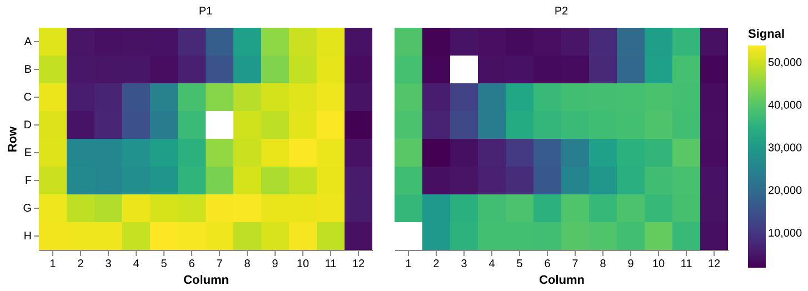
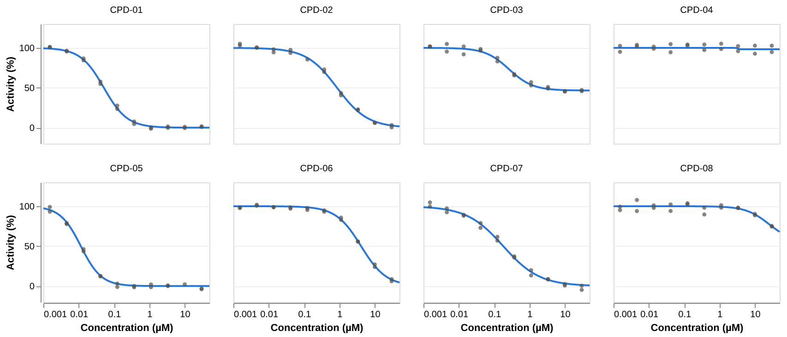

<!-- Generated by vignettes/knit.nim from vignettes/dataframes.nim: edit that, not this. -->

# Plate data in a data frame

drc's fitting functions take plain sequences of doses and responses, so
the data can come from anywhere. This vignette takes a plate reader
export through [racoon](https://github.com/Swarchal/Racoon), a small data
frame library for Nim. It reads the CSV, checks the plates, normalises
each plate to its own controls, fits one curve per compound with
`groupBy`, and collects the results in a frame of their own. racoon
frames go straight to plotter through the `plotter/racoon` bridge.

Like plotter, racoon is not a drc dependency: only the vignettes use it.

## Reading the plates

`vignettes/data/plate_screen.csv` holds two simulated 96-well plates in
long format, one row per well: the plate, the well, what is in it, its
concentration in µM and the raw signal. Column 1 of each plate is the
negative control (DMSO, 100% activity) and column 12 the positive
control (staurosporine, STS, 0%). Each plate has four compounds, each
in two rows of a 3-fold dilution series from 30 µM down to 1.5 nM.
`toDataFrame` parses the CSV and infers each column's type, shown under
its name:

```nim
import std/[math, sequtils, stats, strformat, strutils, tables]
import drc
import drcplot
import racoon
import plotter/racoon as bridge # toDataFrame(racoon.DataFrame) → a plotter frame

let raw = readFile("vignettes/data/plate_screen.csv").toDataFrame()
echo raw
```

```
+-------+-------+----------+----------+--------+
| plate |  well | compound |  conc_um | signal |
| <str> | <str> |    <str> |  <float> |  <int> |
+-------+-------+----------+----------+--------+
|    P1 |   A01 |     DMSO |      0.0 |  51601 |
|    P1 |   A02 |   CPD-01 |     30.0 |   4626 |
|    P1 |   A03 |   CPD-01 |     10.0 |   3960 |
|    P1 |   A04 |   CPD-01 | 3.333333 |   4098 |
|    P1 |   A05 |   CPD-01 | 1.111111 |   4316 |
|    P1 |   A06 |   CPD-01 |  0.37037 |   7863 |
|    P1 |   A07 |   CPD-01 | 0.123457 |  17296 |
|    P1 |   A08 |   CPD-01 | 0.041152 |  31498 |
|    P1 |   A09 |   CPD-01 | 0.013717 |  45245 |
|    P1 |   A10 |   CPD-01 | 0.004572 |  49819 |
|   ... |   ... |      ... |      ... |    ... |
|    P2 |   H03 |   CPD-08 |     10.0 |  35512 |
|    P2 |   H04 |   CPD-08 | 3.333333 |  38282 |
|    P2 |   H05 |   CPD-08 | 1.111111 |  38275 |
|    P2 |   H06 |   CPD-08 |  0.37037 |  38268 |
|    P2 |   H07 |   CPD-08 | 0.123457 |  40227 |
|    P2 |   H08 |   CPD-08 | 0.041152 |  39696 |
|    P2 |   H09 |   CPD-08 | 0.013717 |  38156 |
|    P2 |   H10 |   CPD-08 | 0.004572 |  41669 |
|    P2 |   H11 |   CPD-08 | 0.001524 |  37175 |
|    P2 |   H12 |      STS |     10.0 |   3875 |
+-------+-------+----------+----------+--------+
shape = [192, 5]
```

Frames over 50 rows print their first and last 10. Three wells have no
signal, because a failed read writes an empty field. racoon reads those
as missing values (NA), so `signal` is still an int column:

```nim
echo raw.countNA()
let signal = raw["signal"]
echo raw.selectRow(toSeq(0 ..< signal.len).filterIt(signal.isNA(it)))
```

```
{"plate": 0, "well": 0, "compound": 0, "conc_um": 0, "signal": 3}
+-------+-------+----------+----------+--------+
| plate |  well | compound |  conc_um | signal |
| <str> | <str> |    <str> |  <float> |  <int> |
+-------+-------+----------+----------+--------+
|    P1 |   D07 |   CPD-02 | 0.123457 |     NA |
|    P2 |   B03 |   CPD-05 |     10.0 |     NA |
|    P2 |   H01 |     DMSO |      0.0 |     NA |
+-------+-------+----------+----------+--------+
shape = [3, 5]
```

## A plate map

A heat map of the raw signal in plate layout shows the controls, the
dilution series and the missing wells at a glance. For that, the well
name has to be split into a row letter and a column number. racoon has
no string operations, but a column's values are an ordinary `seq`
(`strs`, `ints`, `floats` or `bools`, by type). Anything racoon lacks
can be done in Nim and added back as a column:

```nim
let wells = raw["well"].strs
let layout = raw.addColumn(
  @[
    toColumn("row", wells.mapIt(it[0 .. 0])),
    toColumn("column", wells.mapIt(parseInt(it[1 .. 2]))),
  ]
)
chart(layout.toDataFrame())
  .markRect()
  .encode(
    x = "column:O".title("Column").axis(labelAngle = 0.0),
    y = "row:O".title("Row"),
    color = "signal:Q".title("Signal").scale(scheme = "viridis"),
  )
  .properties(width = 300, height = 200)
  .facet(column = "plate:N".title(""))
  .configureBackground("#ffffff")
  .configureView(noStroke = true)
  .figure("plates", "Heat maps of the raw signal on the two plates, in plate layout")
```



The missing wells are the gaps. Each plate's top concentration is in
column 2. Rows G–H of P1 stay bright: that compound is inactive. P2's
signal is lower all over, even in its DMSO column, so raw signals
can't be compared across plates. Each plate has to be normalised to its
own controls.

## Controls and plate quality

`dropNA` drops the missing wells. Comparisons are element-wise and give
a bool column, `or` combines two of them, and indexing a frame with the
result keeps the matching rows. `groupBy` and `aggregate` then summarise
each plate's controls:

```nim
let read = raw.dropNA("signal")
proc isControl(df: racoon.DataFrame): Column =
  df["compound"].eq("DMSO") or df["compound"].eq("STS")

let controls = read[read.isControl]
echo controls.groupBy(@["plate", "compound"]).aggregate(
  @[
    agg("signal", agCount, "wells"),
    agg("signal", agMean),
    agg("signal", agMin),
    agg("signal", agMax),
  ]
)
```

```
+-------+----------+-------+--------------------+------------+------------+
| plate | compound | wells |        signal_mean | signal_min | signal_max |
| <str> |    <str> | <int> |            <float> |      <int> |      <int> |
+-------+----------+-------+--------------------+------------+------------+
|    P1 |     DMSO |     8 |          51515.625 |      49401 |      52966 |
|    P1 |      STS |     8 |           4192.375 |       2116 |       5670 |
|    P2 |     DMSO |     7 | 38906.142857142855 |      36535 |      40622 |
|    P2 |      STS |     8 |           3627.375 |       2443 |       4300 |
+-------+----------+-------+--------------------+------------+------------+
shape = [4, 6]
```

racoon has no standard deviation yet, but `std/stats` does. The Z′
factor, 1 − 3(sd₋ + sd₊)/|mean₋ − mean₊|, measures how well the controls
separate: above 0.5 is an excellent assay. `groups` iterates over the
groups, giving each one's key values and its rows as a frame:

```nim
var negative, positive: Table[string, float] # mean control signal, by plate
for (key, plate) in controls.groupBy("plate").groups:
  let name = $key["plate"]
  let neg = plate[plate["compound"].eq("DMSO")]["signal"].ints.mapIt(float(it))
  let pos = plate[plate["compound"].eq("STS")]["signal"].ints.mapIt(float(it))
  negative[name] = neg.mean
  positive[name] = pos.mean
  let zPrime =
    1 - 3 * (neg.standardDeviationS + pos.standardDeviationS) / abs(neg.mean - pos.mean)
  echo &"{name}: Z′ = {zPrime:.2f}"
```

```
P1: Z′ = 0.85
P2: Z′ = 0.83
```

Both plates pass, even with a different signal window on each.

## Normalising each plate

Each well becomes % activity on its own plate's controls,
100 · (signal − mean₊)/(mean₋ − mean₊). Column arithmetic is
element-wise and broadcasts a number to every row. An int column minus
a float gives a float column, and the result is named after the
expression until `rename` names it. The plates are normalised one group
at a time, and `concat` stacks them back into one frame:

```nim
var plates: seq[racoon.DataFrame]
for (key, plate) in read.groupBy("plate").groups:
  let name = $key["plate"]
  let activity =
    (plate["signal"] - positive[name]) / (negative[name] - positive[name]) * 100.0
  plates.add plate.addColumn(activity.rename("activity"))
let normalised = concat(plates)
echo normalised.head(5)
```

```
+-------+-------+----------+----------+--------+----------------------+
| plate |  well | compound |  conc_um | signal |             activity |
| <str> | <str> |    <str> |  <float> |  <int> |              <float> |
+-------+-------+----------+----------+--------+----------------------+
|    P1 |   A01 |     DMSO |      0.0 |  51601 |    100.1804081503278 |
|    P1 |   A02 |   CPD-01 |     30.0 |   4626 |   0.9163043535682777 |
|    P1 |   A03 |   CPD-01 |     10.0 |   3960 | -0.49103770345443304 |
|    P1 |   A04 |   CPD-01 | 3.333333 |   4098 | -0.19942628623351102 |
|    P1 |   A05 |   CPD-01 | 1.111111 |   4316 |  0.26123522792707604 |
+-------+-------+----------+----------+--------+----------------------+
shape = [5, 6]
```

## One fit per compound

Grouping the samples by compound gives each compound's wells as a frame
of its own. Its `conc_um` and `activity` columns, as `seq[float]`, are
the doses and responses that `fitLL4` takes. As in the [screening
vignette](screening.md), Top is fixed at 100 and Bottom is bounded to
0–100. The doses stay in µM, so the IC50s come out in µM too.

```nim
let samples = normalised[not normalised.isControl]
var compounds, compoundPlate: seq[string]
var fits: seq[DrcFit]
for (key, wells) in samples.groupBy("compound").groups:
  compounds.add $key["compound"]
  compoundPlate.add $wells["plate"][0]
  fits.add fitLL4(
    wells["conc_um"].floats,
    wells["activity"].floats,
    fixed = [(Top, 100.0)],
    bounds = [(Bottom, 0.0 .. 100.0)],
  )
```

The results go into a frame of their own, built from columns. An IC50
is reported only where the fit pins it down: its 95% interval spans
less than a factor of 10. Elsewhere it is missing, so its column is
built from `Value`s, with `NA` for the holes. Values are rounded to 3 significant
figures for printing.

```nim
proc sig3(x: float): float =
  parseFloat(formatFloat(x, ffDefault, 3))

proc located(fit: DrcFit, x: float): racoon.Value =
  ## `x`, or NA when the fit does not pin the EC50 down.
  let ci = fit.ec50CI
  if ci.upper / ci.lower < 10:
    toValue(sig3(x))
  else:
    NA

let results = toDataFrame(
  @[
    toColumn("compound", compounds),
    toColumn("plate", compoundPlate),
    toColumn("ic50_um", fits.mapIt(it.located(it.ec50)), ckFloat),
    toColumn("lower_um", fits.mapIt(it.located(it.ec50CI.lower)), ckFloat),
    toColumn("upper_um", fits.mapIt(it.located(it.ec50CI.upper)), ckFloat),
    toColumn("bottom", fits.mapIt(round(it.params[Bottom] * 10) / 10)),
  ]
)
echo results.sorted("ic50_um")
```

```
+----------+-------+---------+----------+----------+---------+
| compound | plate | ic50_um | lower_um | upper_um |  bottom |
|    <str> | <str> | <float> |  <float> |  <float> | <float> |
+----------+-------+---------+----------+----------+---------+
|   CPD-05 |    P2 |  0.0115 |   0.0106 |   0.0125 |     0.0 |
|   CPD-01 |    P1 |  0.0515 |   0.0481 |   0.0552 |     0.0 |
|   CPD-07 |    P2 |   0.181 |    0.149 |    0.219 |     0.0 |
|   CPD-03 |    P1 |   0.262 |    0.208 |    0.331 |    46.6 |
|   CPD-02 |    P1 |   0.856 |     0.73 |      1.0 |     0.0 |
|   CPD-06 |    P2 |    4.09 |     3.57 |     4.69 |     0.0 |
|   CPD-04 |    P1 |      NA |       NA |       NA |    98.3 |
|   CPD-08 |    P2 |      NA |       NA |       NA |    55.4 |
+----------+-------+---------+----------+----------+---------+
shape = [8, 6]
```

Sorting puts the missing IC50s last. CPD-04 is inactive, and CPD-08
has fallen only to about 75% by 30 µM, so the data pin down neither
IC50 (CPD-04's interval runs from 0 to ∞). CPD-03 is a partial
inhibitor, levelling off near 47% activity.

A comparison with a missing value is missing, and a filter does not
count that as a match. So the compounds with an IC50 below 1 µM are:

```nim
echo results[results["ic50_um"] < 1.0][@["compound", "ic50_um"]]
```

```
+----------+---------+
| compound | ic50_um |
|    <str> | <float> |
+----------+---------+
|   CPD-01 |  0.0515 |
|   CPD-02 |   0.856 |
|   CPD-03 |   0.262 |
|   CPD-05 |  0.0115 |
|   CPD-07 |   0.181 |
+----------+---------+
shape = [5, 2]
```

`toString` writes a frame back out as CSV, ready for `writeFile`.
Missing cells become empty fields, as they were read:

```nim
echo results.toString()
```

```
compound,plate,ic50_um,lower_um,upper_um,bottom
CPD-01,P1,0.0515,0.0481,0.0552,0.0
CPD-02,P1,0.856,0.73,1.0,0.0
CPD-03,P1,0.262,0.208,0.331,46.6
CPD-04,P1,,,,98.3
CPD-05,P2,0.0115,0.0106,0.0125,0.0
CPD-06,P2,4.09,3.57,4.69,0.0
CPD-07,P2,0.181,0.149,0.219,0.0
CPD-08,P2,,,,55.4
```

## The curves

To plot the fitted curves over the data, both go in one long frame.
The curves are predictions on a grid of doses, built as columns. The
observations are columns of `samples`, renamed to match. A `kind`
column tells the two apart. `concat` matches columns by name, not
position, and the bridge converts the result for plotter:

```nim
let axis = doseAxis("Concentration (µM)", 1e-3, 50.0)
var curveCompound: seq[string]
var curveDose, curveActivity: seq[float]
for i, fit in fits:
  for d in axis.doseGrid(100):
    curveCompound.add compounds[i]
    curveDose.add d
    curveActivity.add fit.predict(d)
let curves = toDataFrame(
  @[
    toColumn("compound", curveCompound),
    toColumn("dose", curveDose),
    toColumn("activity", curveActivity),
    toColumn("kind", newSeqWith(curveDose.len, "fit")),
  ]
)
let observed = toDataFrame(
  @[
    samples["compound"],
    samples["conc_um"].rename("dose"),
    samples["activity"],
    toColumn("kind", newSeqWith(samples.shape[0], "observed")),
  ]
)
let both = concat(curves, observed)
echo both.shape

let yAxis =
  "activity:Q".title("Activity (%)").scale(domain = vals(-20.0, 130.0), nice = false)
layer(
  Chart()
    .transformFilter("datum.kind == 'fit'")
    .markLine(color = blue, strokeWidth = 2)
    .encode(x = axis.x, y = yAxis),
  Chart()
    .transformFilter("datum.kind == 'observed'")
    .markPoint(filled = true, color = ink, size = 20)
    .encode(x = axis.x, y = yAxis),
)
  .withData(inlineData(both.toDataFrame()))
  .properties(width = 180, height = 130)
  .facet(facet = "compound:N".title(""), columns = 4)
  .configureBackground("#ffffff")
  .configureAxis(gridColor = "#eeeeee")
  .figure("curves", "Fitted curves of the eight compounds, one panel each")
```

```
[958, 4]
```



## Name clashes

racoon and plotter both define a `DataFrame` and a `Value` type, so code
that uses both names those two types in full, as `racoon.DataFrame` above.
Their procs take different argument types, so overloading tells them
apart and the procs need no qualification.

## Next

- [Screening](screening.md): triaging the fits of a larger screen into
  hits, weak compounds and inactives.
- [Relative potency](potency.md): fitting several curves jointly, with
  shared parameters.
