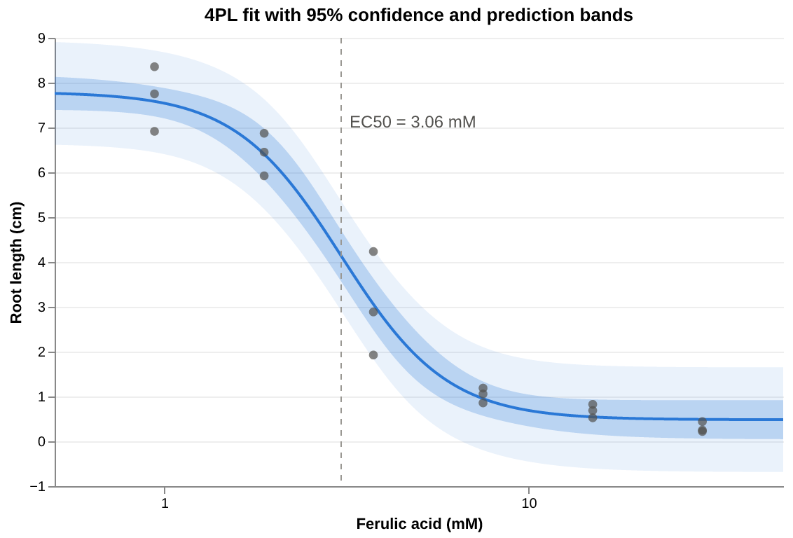
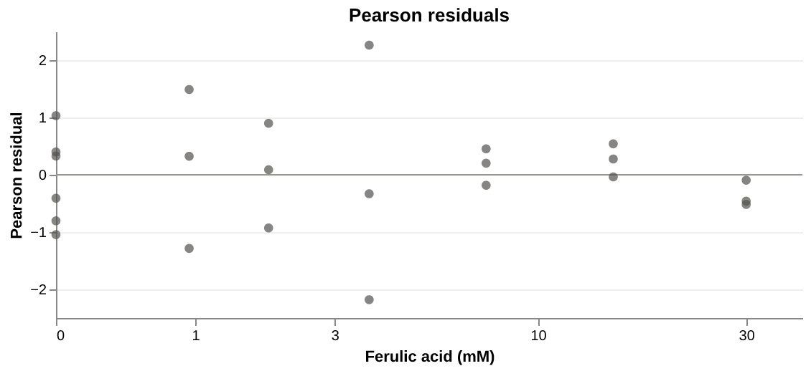

<!-- Generated by vignettes/knit.nim from vignettes/getting_started.nim: edit that, not this. -->

# Getting started: fitting a dose-response curve

Fit a four-parameter logistic curve to a classic data set, read off the
EC50 and other effective doses with confidence intervals, draw the curve
with its uncertainty, and check the fit through its residuals.

The figures in these vignettes are drawn with
[plotter](https://github.com/Swarchal/nim-plotter), through a few helpers
in [`vignettes/drcplot.nim`](../../vignettes/drcplot.nim) (`doseAxis`,
`curveLine`, `bands`, `dots`, `figure`, …). drc itself does no plotting
and does not depend on plotter.

## The data

The `ryegrass` data from R's drc package: the root length of perennial
ryegrass after growing in solutions of ferulic acid. There are six
untreated controls (dose 0) and triplicates at six concentrations (mM).

```nim
import std/[math, strformat]
import drc
import drcplot

let doses = [
  0.0, 0.0, 0.0, 0.0, 0.0, 0.0, 0.94, 0.94, 0.94, 1.88, 1.88, 1.88, 3.75, 3.75, 3.75,
  7.5, 7.5, 7.5, 15.0, 15.0, 15.0, 30.0, 30.0, 30.0,
]
let rootLength = [
  7.58, 8.0, 8.3285714, 7.25, 7.375, 7.9625, 8.3555556, 6.9142857, 7.75, 6.8714286,
  6.45, 5.9222222, 1.925, 2.8857143, 4.2333333, 1.1875, 0.8571429, 1.0571429, 0.6875,
  0.525, 0.825, 0.25, 0.22, 0.44,
]
```

## Fitting the curve

`fitLL4` fits the four-parameter logistic (the Hill equation) against
x = log10(dose):

```
f(x) = Bottom + (Top − Bottom) / (1 + 10^((LogEC50 − x) · Hill))
```

Zero doses are kept: they sit at x = −∞, on the low-dose plateau. No
starting values are needed. `summary` gives the estimates with standard
errors and 95% confidence intervals:

```nim
let fit = fitLL4(doses, rootLength)
echo fit.summary
```

```
4PL fit to 24 observations

              Estimate   Std.Error     Lower 95%     Upper 95%
Bottom        0.481410    0.209506     0.0443880      0.918432
Top            7.79296    0.189733       7.39719       8.18874
LogEC50       0.485431   0.0263916      0.430379      0.540483
Hill          -2.98223    0.458429      -3.93849      -2.02596
EC50           3.05796                   2.69389       3.47123

Residual standard error: 0.519626 on 20 degrees of freedom
R²: 0.978252   AIC: 42.3103   BIC: 48.2006
Stopped after 7 iterations: relative change in SSR below ftol
```

Hill is negative because root length *falls* with dose. The estimates
match the ones published for R's drc package.

## Drawing it

The fitted curve with its 95% confidence band (where the mean response
lies) and the wider 95% prediction band (where a new observation is
expected to fall). A log axis has no place for a dose of 0, so the
controls are in the fit but not on the plot.

```nim
let axis = doseAxis("Ferulic acid (mM)", 0.5, 50.0)
layer(
  axis.bands(fit),
  axis.curveLine(fit, "Root length (cm)"),
  axis.doseRule(fit.ec50, &"EC50 = {fit.ec50:.2f} mM"),
  axis.dots(axis.observationFrame(doses, rootLength)),
)
  .finish("4PL fit with 95% confidence and prediction bands")
  .figure("fit", "4PL fit of the ryegrass data")
```



## Working with the estimates

`fit.params`, `fit.se` and `confint` are indexed by parameter. LogEC50 is
on the log10 scale, so `fit.ec50` gives the dose itself:

```nim
echo &"Hill = {fit.params[Hill]:.3f} ± {fit.se[Hill]:.3f}"
let (lo, hi) = fit.confint(Hill)
echo &"95% CI for Hill: {lo:.3f} to {hi:.3f}"
echo &"EC50 = {fit.ec50:.3f} mM = 10^{fit.params[LogEC50]:.4f}"
```

```
Hill = -2.982 ± 0.458
95% CI for Hill: -3.938 to -2.026
EC50 = 3.058 mM = 10^0.4854
```

The EC50 is only one effective dose. `ecx(p)` is the dose that gives p% of
the change from the low-dose plateau to the high-dose one, and `ecxCI`
its interval. ECx intervals are computed on the log-dose scale, so they
are not symmetric about the estimate:

```nim
for pct in [10.0, 20.0, 50.0, 80.0, 90.0]:
  let ci = fit.ecxCI(pct)
  echo &"EC{pct:<3g} {fit.ecx(pct):6.3f} mM   95% CI [{ci.lower:.3f}, {ci.upper:.3f}]"
```

```
EC10   1.464 mM   95% CI [1.118, 1.916]
EC20   1.921 mM   95% CI [1.578, 2.339]
EC50   3.058 mM   95% CI [2.694, 3.471]
EC80   4.868 mM   95% CI [4.006, 5.914]
EC90   6.389 mM   95% CI [4.892, 8.344]
```

Going the other way, `predict` gives the fitted response at a dose, and
`doseAt` the dose that gives a response:

```nim
echo &"root length at 5 mM: {fit.predict(5.0):.2f} cm"
echo &"dose that halves the control root length: {fit.doseAt(fit.params[Top] / 2):.2f} mM"
```

```
root length at 5 mM: 1.85 cm
dose that halves the control root length: 3.20 mM
```

That is not the EC50, which is half-way between the *fitted* plateaus, and
Bottom is not 0 here. The [confidence intervals
vignette](intervals.md) covers this distinction (relative vs absolute
EC50) further.

## Checking the fit

A fit reports problems in `fit.warnings` instead of raising, so check it
(and `converged`) before trusting the numbers:

```nim
echo "converged: ", fit.converged
echo "warnings: ", fit.warnings
echo &"R² = {fit.rSquared:.4f}, residual SE = {fit.sigma:.3f} on {fit.df} df"
```

```
converged: true
warnings: {}
R² = 0.9783, residual SE = 0.520 on 20 df
```

A good R² says little about whether the *shape* is right. Pearson
residuals (residual / σ) should scatter evenly around 0 at every dose,
mostly within ±2, with no runs of one sign:

```nim
let residualFrame =
  dataFrame(col("dose", @(fit.doses)), col("residual", fit.pearsonResiduals))
layer(
  chart(dataFrame(col("residual", @[0.0]))).markRule(color = muted).encode(
    y = "residual:Q"
  ),
  chart(residualFrame).markPoint(filled = true, color = ink, size = dotSize).encode(
    x = "dose:Q"
      .scale(
        scaleType = scSymlog,
        domain = vals(0.0, 40.0),
        nice = false,
        raw = %*{"constant": 1},
      )
      .axis(
        title = "Ferulic acid (mM)",
        grid = false,
        values = vals(0.0, 1.0, 3.0, 10.0, 30.0),
      ),
    y = "residual:Q".title("Pearson residual"),
  ),
)
  .finish("Pearson residuals", h = 200)
  .figure("residuals", "Pearson residuals of the 4PL fit against dose")
```



(A symmetric-log axis puts the controls at 0 on the left.) Nothing stands
out. With replicates at each dose there is also a formal test of the
curve's shape, `lackOfFit`, which compares the curve with the dose means:

```nim
let t = fit.lackOfFit
echo &"lack of fit: F = {t.f:.2f} on {t.df1} and {t.df2} df, p = {t.p:.3f}"
```

```
lack of fit: F = 0.24 on 3 and 17 df, p = 0.866
```

A large p means the curve misses the dose means by no more than the
scatter between replicates explains.

## Next

- [Choosing a model](model_choice.md): 3PL, 4PL or 5PL, fixed plateaus
  and bounds.
- [Confidence intervals](intervals.md): Wald, profile-likelihood and
  bootstrap intervals, and when they disagree.
