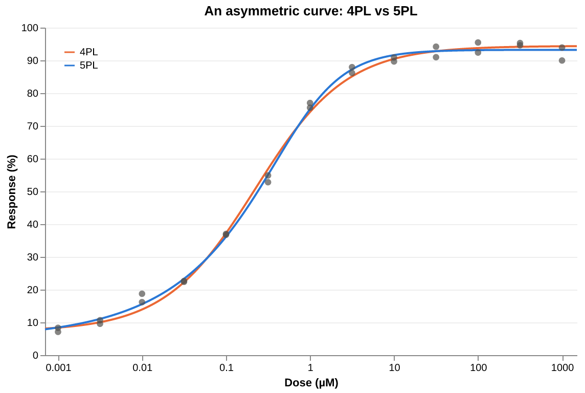
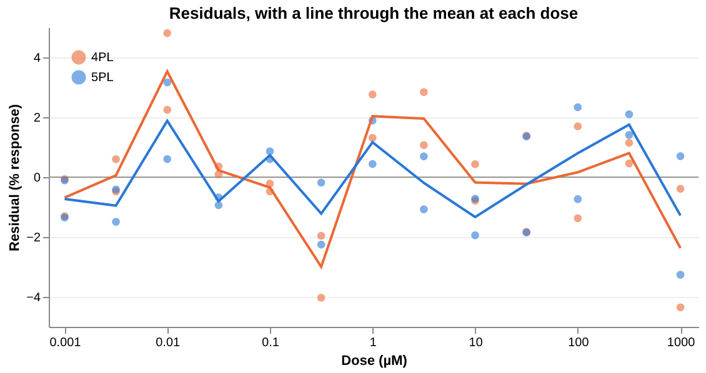
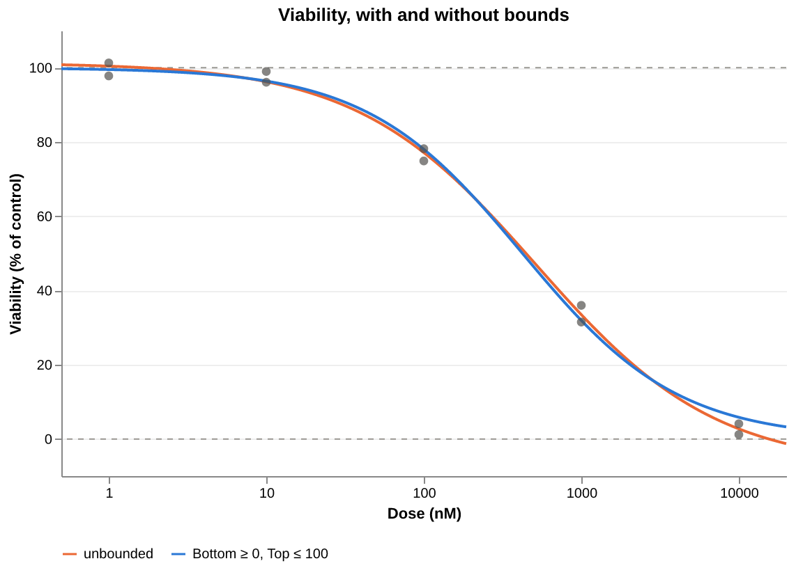

<!-- Generated by vignettes/knit.nim from vignettes/model_choice.nim: edit that, not this. -->

# Choosing a model

drc fits three members of one family: the 3PL, the 4PL and the 5PL. This
vignette shows when to fix a plateau, when an asymmetric 5PL earns its
extra parameter, how to compare candidate models (by AIC, by a lack-of-fit
test and by their residuals), and how bounds keep plateaus possible.

## One family of curves

Every model is the five-parameter logistic in x = log10(dose):

```
f(x) = Bottom + (Top − Bottom) / (1 + 10^((LogEC50 − x) · Hill))^Asymmetry
```

The 4PL is the 5PL with Asymmetry fixed at 1, and the 3PL is the 4PL with
Bottom fixed (at 0 unless `fixed` says otherwise). Fewer free parameters
means more stable estimates, provided the constraint is true.

## Normalised data: fix what you already know

Responses normalised to controls (% of untreated) have plateaus that are
known in advance. With only six doses, fixing them leaves the data to
pin down just the EC50 and the slope:

```nim
import std/[math, sequtils, strformat]
import drc
import drcplot

let doses = [1e-9, 1e-8, 1e-7, 1e-6, 1e-5, 1e-4] # molar
let viability = [98.2, 95.1, 71.4, 22.9, 6.3, 2.0] # % of untreated control

let free4 = fitLL4(doses, viability)
let fixed4 = fitLL4(doses, viability, fixed = [(Bottom, 0.0), (Top, 100.0)])
let threePL = fitLL3(doses, viability)
for (name, fit) in [
  ("4PL, all free", free4), ("4PL, 0 and 100", fixed4), ("3PL", threePL)
]:
  let ci = fit.ec50CI
  echo &"{name:<15} IC50 {fit.ec50 * 1e9:6.1f} nM  (95% CI {ci.lower * 1e9:6.1f}–{ci.upper * 1e9:6.1f}), {fit.df} df"
```

```
4PL, all free   IC50  259.2 nM  (95% CI  206.5– 325.5), 2 df
4PL, 0 and 100  IC50  272.8 nM  (95% CI  227.9– 326.5), 4 df
3PL             IC50  278.2 nM  (95% CI  207.5– 373.0), 3 df
```

The IC50s are close. Fixing both plateaus gives the narrowest interval,
even though the fit is worse (the free fit puts Bottom at 2.5 and Top at
98.9): two fewer parameters to estimate outweigh that. Fixing only Bottom
gives the widest, since it pays for the worse fit with only one extra
degree of freedom. A constraint helps only as much as it is true.

`fitLL3(doses, viability, fixed = [(Bottom, 5.0)])` fixes Bottom at a
value other than 0. Fixed parameters have a standard error of 0:

```nim
echo fixed4.summary
```

```
4PL fit to 6 observations

              Estimate   Std.Error     Lower 95%     Upper 95%
Bottom         0.00000     (fixed)
Top            100.000     (fixed)
LogEC50       -6.56415   0.0281230      -6.64223      -6.48606
Hill         -0.885682   0.0424383      -1.00351     -0.767854
EC50       2.72806e-07               2.27915e-07   3.26540e-07

Residual standard error: 1.62000 on 4 degrees of freedom
R²: 0.998924   AIC: 26.3836   BIC: 25.7589
Stopped after 8 iterations: relative change in SSR below ftol
```

## Asymmetric curves: 4PL or 5PL?

These data rise steeply from the bottom but approach the top slowly. A 4PL
is symmetric about its midpoint, so it cannot follow both ends:

```nim
var asymDoses = @[0.0, 0.0] # two untreated controls
for k in 0 .. 12: # 1 nM to 1 mM in half-log steps, duplicates
  let dose = pow(10.0, -9.0 + 0.5 * float(k))
  asymDoses.add [dose, dose]
let responses = [
  5.0, 5.6, 8.34, 7.1, 10.65, 9.57, 16.18, 18.74, 22.64, 22.38, 37.01, 36.75, 54.87,
  52.8, 75.55, 77.0, 86.17, 87.94, 89.67, 90.89, 90.97, 94.18, 92.39, 95.46, 95.3,
  94.61, 89.96, 93.92,
]
```

`fitCurve` takes the model as an argument, so candidate models can be
fitted in a loop and compared. A lower AIC is better, and `lackOfFit`
tests each curve against the dose means, using the scatter between
duplicates as pure error:

```nim
var fits: seq[DrcFit]
for model in [LL4, LL5]:
  let fit = fitCurve(model, asymDoses, responses)
  let t = fit.lackOfFit
  echo &"{model}: AIC {fit.aic:6.1f}, lack of fit F = {t.f:.2f} on {t.df1} and {t.df2} df, p = {t.p:.4f}"
  fits.add fit
let (four, five) = (fits[0], fits[1])
```

```
4PL: AIC  127.5, lack of fit F = 3.99 on 10 and 14 df, p = 0.0095
5PL: AIC  113.3, lack of fit F = 1.80 on 9 and 14 df, p = 0.1559
```

The 5PL wins on AIC by 14, and only the 4PL fails the lack-of-fit test.
The difference is plain on the plot:

```nim
let axis = doseAxis("Dose (µM)", 7e-4, 1.5e3, fittedToDisplay = 1e6)
let curves = [labelled("4PL", four), labelled("5PL", five)]
let color = seriesColors(curves.mapIt(it.label), [orange, blue], legendAt = "top-left")
layer(
  axis.curveLines(curves, "Response (%)", color),
  axis.dots(axis.observationFrame(asymDoses, responses)),
)
  .finish("An asymmetric curve: 4PL vs 5PL")
  .figure("asymmetric", "4PL and 5PL fits of asymmetric data")
```



The residuals show where. Here are the raw residuals (in % response, so
the two models are on one scale), with a line through their mean at each
dose:

```nim
var points, means: tuple[dose, residual: seq[float], series: seq[string]]
for curve in curves:
  let r = curve.fit.residuals
  for i in countup(2, r.high, 2): # duplicates; skip the controls at dose 0
    for j in [i, i + 1]:
      points.dose.add axis.toDisplay(asymDoses[j])
      points.residual.add r[j]
      points.series.add curve.label
    means.dose.add axis.toDisplay(asymDoses[i])
    means.residual.add (r[i] + r[i + 1]) / 2
    means.series.add curve.label
proc frame(t: typeof(points)): DataFrame =
  dataFrame(col("dose", t.dose), col("residual", t.residual), col("series", t.series))

layer(
  chart(dataFrame(col("residual", @[0.0]))).markRule(color = muted).encode(
    y = "residual:Q"
  ),
  chart(points.frame).markPoint(filled = true, size = dotSize, opacity = 0.6).encode(
    x = axis.x, y = "residual:Q".title("Residual (% response)"), color = color
  ),
  chart(means.frame).markLine(strokeWidth = 2).encode(
    x = axis.x, y = "residual:Q", color = color
  ),
)
  .finish("Residuals, with a line through the mean at each dose", h = 240)
  .figure("residuals", "Residuals of the 4PL and 5PL fits against dose")
```



The 4PL misses the dose means by up to 3.5 points: it is too high at
the controls (by 2.0, not shown), too low at 10 nM and too high at 316 nM. The
5PL's dose means all lie within ±1.9.

In a 5PL, LogEC50 is a location parameter, not the log of the half-way
dose. Use `ec50` and `ecx`, which solve for the actual dose in every model:

```nim
echo five.summary
echo &"10^LogEC50 = {round(pow(10.0, five.params[LogEC50]) * 1e9).int} nM, but EC50 = {round(five.ec50 * 1e9).int} nM"
```

```
5PL fit to 28 observations

              Estimate   Std.Error     Lower 95%     Upper 95%
Bottom         4.88039     1.01725       2.77605       6.98472
Top            93.2261    0.580843       92.0246       94.4277
LogEC50       -6.08146   0.0909446      -6.26960      -5.89333
Hill           1.21811    0.144526      0.919131       1.51708
Asymmetry     0.392014   0.0764095      0.233949      0.550079
EC50       2.26380e-07               2.01742e-07   2.54026e-07

Residual standard error: 1.63042 on 23 degrees of freedom
R²: 0.998314   AIC: 113.327   BIC: 121.321
Stopped after 12 iterations: relative change in SSR below ftol
10^LogEC50 = 829 nM, but EC50 = 226 nM
```

The 5PL's parameters are strongly correlated (Asymmetry trades off against
LogEC50 and Hill), and it needs data across both plateaus. Prefer the 4PL
unless the asymmetry is clear, as it is here.

## Testing a constraint: is the slope standard?

Fixing a parameter is also a hypothesis. Here, does a free Hill slope fit
the ryegrass data better than the standard Hill = −1? Compare the two fits
by AIC (the fixed fit has one parameter fewer):

```nim
let ryeDoses = [
  0.0, 0.0, 0.0, 0.0, 0.0, 0.0, 0.94, 0.94, 0.94, 1.88, 1.88, 1.88, 3.75, 3.75, 3.75,
  7.5, 7.5, 7.5, 15.0, 15.0, 15.0, 30.0, 30.0, 30.0,
]
let rootLength = [
  7.58, 8.0, 8.3285714, 7.25, 7.375, 7.9625, 8.3555556, 6.9142857, 7.75, 6.8714286,
  6.45, 5.9222222, 1.925, 2.8857143, 4.2333333, 1.1875, 0.8571429, 1.0571429, 0.6875,
  0.525, 0.825, 0.25, 0.22, 0.44,
]
let freeHill = fitLL4(ryeDoses, rootLength)
let unitHill = fitLL4(ryeDoses, rootLength, fixed = [(Hill, -1.0)])
echo &"free Hill = {freeHill.params[Hill]:.2f}: AIC {freeHill.aic:.2f}"
echo &"Hill = -1:      AIC {unitHill.aic:.2f}"
```

```
free Hill = -2.98: AIC 42.31
Hill = -1:      AIC 71.89
```

A difference of more than 20 rejects the standard slope decisively: the
ryegrass response is about three times as steep.

## Impossible plateaus: bounds

An unconstrained fit can put a plateau somewhere impossible, especially
when the data stop short of it or are noisy near it. Here viability (% of
control) overshoots: the free fit puts Bottom below 0 and Top above 100. Bounds keep each parameter in
a range but let the data place it there:

```nim
let partialDoses = [1e-9, 1e-9, 1e-8, 1e-8, 1e-7, 1e-7, 1e-6, 1e-6, 1e-5, 1e-5] # molar
let partial = [101.3, 97.8, 96.1, 99.0, 78.2, 74.9, 31.5, 36.0, 4.1, 1.2] # % of control

let unbounded = fitLL4(partialDoses, partial)
let bounded =
  fitLL4(partialDoses, partial, bounds = [(Bottom, 0.0 .. Inf), (Top, -Inf .. 100.0)])
for (name, fit) in [("unbounded", unbounded), ("bounded", bounded)]:
  echo &"{name:<10} Bottom {fit.params[Bottom]:6.2f}, Top {fit.params[Top]:6.2f}, IC50 {fit.ec50 * 1e9:.1f} nM"
echo "at a bound: ", bounded.atBound
echo "warnings: ", bounded.warnings
```

```
unbounded  Bottom  -7.59, Top 101.36, IC50 517.7 nM
bounded    Bottom   0.00, Top 100.00, IC50 423.1 nM
at a bound: {Bottom, Top}
warnings: {a parameter is at a bound; its standard error and interval ignore the bound}
```

Both plateaus end on their bounds, which is reported in `atBound` and as a
warning. A bound that binds means the data alone would put the parameter
elsewhere, so the other estimates depend on the choice: the IC50 moves
from 518 to 423 nM.

```nim
let partialAxis = doseAxis("Dose (nM)", 0.5, 2e4, fittedToDisplay = 1e9)
let partialCurves =
  [labelled("unbounded", unbounded), labelled("Bottom ≥ 0, Top ≤ 100", bounded)]
let partialColor =
  seriesColors(partialCurves.mapIt(it.label), [orange, blue], legendAt = "bottom")
layer(
  responseRule(0.0),
  responseRule(100.0),
  partialAxis.curveLines(partialCurves, "Viability (% of control)", partialColor),
  partialAxis.dots(partialAxis.observationFrame(partialDoses, partial)),
)
  .finish("Viability, with and without bounds")
  .figure("bounds", "Unbounded and bounded 4PL fits of viability data")
```



A parameter on a bound still counts as free in `df` and AIC, and its
standard error ignores the bound, as in R's `nls(algorithm = "port")`.

## Next

- [Confidence intervals](intervals.md): Wald, profile-likelihood and
  bootstrap intervals, and when they disagree.
- [Outliers](outliers.md): robust fits that downweight bad wells.
- [Relative potency](potency.md): several curves fitted together.
- [Standard curves](standard_curves.md): reading unknowns off a curve.
- [Screening](screening.md): fitting many compounds at once.
