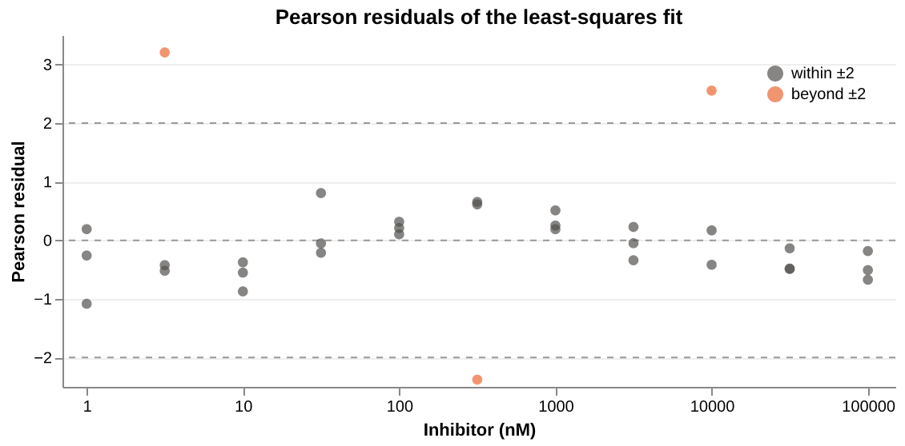
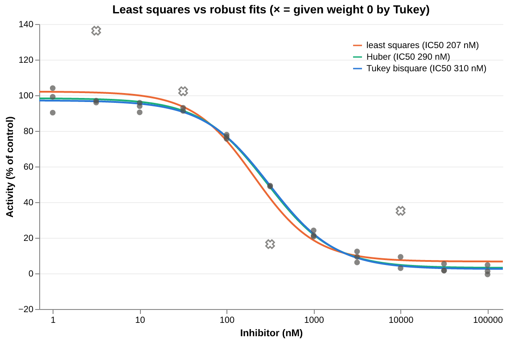
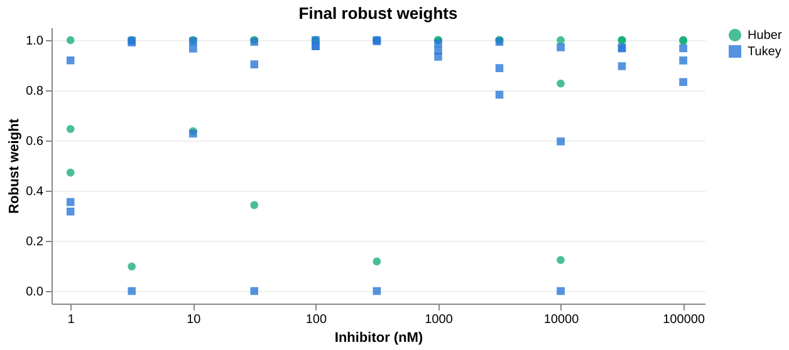

<!-- Generated by vignettes/knit.nim from vignettes/outliers.nim: edit that, not this. -->

# Outliers and robust fitting

A few bad wells can drag a least-squares curve a long way. This vignette
finds them in the residuals, then fits the curve robustly with Huber and
Tukey losses, which downweight or reject large residuals automatically,
and compares that with removing known-bad wells by hand.

## The data

A simulated inhibition assay: % activity in triplicate at nine half-log
concentrations, with a true IC50 of 316 nM. Three wells (4, 16 and 25,
counting from 0) had gross errors added, as a pipetting slip or a bubble
would.

```nim
import std/[math, sequtils, strformat]
import drc
import drcplot

let doses = [
  1e-9, 1e-9, 1e-9, 3.16e-9, 3.16e-9, 3.16e-9, 1e-8, 1e-8, 1e-8, 3.16e-8, 3.16e-8,
  3.16e-8, 1e-7, 1e-7, 1e-7, 3.16e-7, 3.16e-7, 3.16e-7, 1e-6, 1e-6, 1e-6, 3.16e-6,
  3.16e-6, 3.16e-6, 1e-5, 1e-5, 1e-5, 3.16e-5, 3.16e-5, 3.16e-5, 1e-4, 1e-4, 1e-4,
] # molar
let activity = [
  104.03, 90.24, 99.16, 95.92, 136.26, 96.97, 90.44, 95.81, 93.91, 102.27, 92.98, 91.24,
  77.88, 76.72, 75.56, 48.83, 16.45, 49.28, 24.15, 20.67, 21.35, 12.34, 9.33, 6.18,
  2.95, 35.12, 9.3, 1.57, 1.65, 5.39, -0.56, 1.22, 4.74,
] # % of control
```

## What least squares does with them

An ordinary fit gives every well the same say, so the bad ones pull the
curve and inflate σ. Its Pearson residuals (residual / σ) still point at
them:

```nim
let ls = fitLL4(doses, activity)
echo &"least squares: IC50 = {ls.ec50 * 1e9:.1f} nM, σ = {ls.sigma:.2f}"
let pearson = ls.pearsonResiduals
for i, r in pearson:
  if abs(r) > 2.0:
    echo &"well {i:>2}: dose {doses[i]:g}, activity {activity[i]:6.2f}, Pearson residual {r:5.2f}"
```

```
least squares: IC50 = 206.8 nM, σ = 10.83
well  4: dose 3.16e-09, activity 136.26, Pearson residual  3.21
well 16: dose 3.16e-07, activity  16.45, Pearson residual -2.38
well 25: dose 1e-05, activity  35.12, Pearson residual  2.55
```

All three planted errors stand out, but only just: well 16 is at −2.4,
barely past the usual ±2. The outliers have inflated σ (from about 2–3
for the good wells to 10.8) and bent the curve towards themselves, which
shrinks their own residuals. Residuals from a fit that the outliers have
distorted are a blunt tool, and the IC50 of 207 nM is well short of 316.

```nim
let axis = doseAxis("Inhibitor (nM)", 0.7, 1.5e5, fittedToDisplay = 1e9)
let flagged = pearson.mapIt(abs(it) > 2.0)
let residualFrame = dataFrame(
  col("dose", doses.mapIt(axis.toDisplay(it))),
  col("residual", pearson),
  col("series", flagged.mapIt(if it: "beyond ±2" else: "within ±2")),
)
layer(
  chart(dataFrame(col("residual", @[-2.0, 0.0, 2.0])))
    .markRule(color = muted, strokeDash = @[4.0, 4.0])
    .encode(y = "residual:Q"),
  chart(residualFrame).markPoint(filled = true, size = dotSize).encode(
    x = axis.x,
    y = "residual:Q".title("Pearson residual"),
    color = seriesColors(["within ±2", "beyond ±2"], [ink, orange], "top-right"),
  ),
)
  .finish("Pearson residuals of the least-squares fit", h = 220)
  .figure("residuals", "Pearson residuals of the least-squares fit against dose")
```



## Robust fits

`FitOptions(loss: Huber)` or `FitOptions(loss: Tukey)` fits by
M-estimation, as R's `robustbase::nlrob`: residuals are scaled by their
robust spread (median |r| / 0.6745), and each round of iteratively
reweighted least squares gives large ones less weight. Huber's weights
shrink gently beyond the cut-off; Tukey's bisquare reaches 0, rejecting a
point outright.

```nim
var fits: seq[LabelledFit]
for loss in [Squared, Huber, Tukey]:
  let fit = fitLL4(doses, activity, opts = FitOptions(loss: loss))
  let ci = fit.ec50CI
  echo &"{$loss:<15} IC50 {fit.ec50 * 1e9:5.1f} nM (95% CI {ci.lower * 1e9:5.1f}–{ci.upper * 1e9:5.1f}), σ = {fit.sigma:.2f}"
  fits.add labelled(&"{loss} (IC50 {round(fit.ec50 * 1e9).int} nM)", fit)
let huber = fits[1].fit
let tukey = fits[2].fit
```

```
least squares   IC50 206.8 nM (95% CI 137.9–310.2), σ = 10.83
Huber           IC50 290.0 nM (95% CI 250.1–336.2), σ = 2.80
Tukey bisquare  IC50 310.4 nM (95% CI 274.6–350.8), σ = 2.27
```

Both robust fits land close to the true 316 nM, with narrower intervals
than least squares. Their σ is the robust scale of the residuals, not the
root mean square, so it is not inflated by the outliers.

```nim
let rejected = tukey.robustWeights.mapIt(it == 0)
layer(
  axis.curveLines(
    fits,
    "Activity (% of control)",
    seriesColors(fits.mapIt(it.label), [orange, aqua, blue], "top-right"),
  ),
  axis.dots(axis.observationFrame(doses, activity, keep = rejected.mapIt(not it))),
  axis.crosses(axis.observationFrame(doses, activity, keep = rejected)),
)
  .finish("Least squares vs robust fits (× = given weight 0 by Tukey)")
  .figure("fits", "Least squares, Huber and Tukey fits of data with outliers")
```



## Which wells were downweighted

`fit.robustWeights` holds each well's final weight: 1 for a well taken at
face value, 0 for one rejected. Always look at them before trusting a
robust fit, since the rejection is automatic. The wells that either fit
gave less than half weight:

```nim
for i in 0 ..< doses.len:
  if huber.robustWeights[i] < 0.5 or tukey.robustWeights[i] < 0.5:
    echo &"well {i:>2}: dose {doses[i]:<8g} activity {activity[i]:6.2f}   Huber {huber.robustWeights[i]:.2f}   Tukey {tukey.robustWeights[i]:.2f}"
```

```
well  0: dose 1e-09    activity 104.03   Huber 0.65   Tukey 0.32
well  1: dose 1e-09    activity  90.24   Huber 0.47   Tukey 0.35
well  4: dose 3.16e-09 activity 136.26   Huber 0.10   Tukey 0.00
well  9: dose 3.16e-08 activity 102.27   Huber 0.34   Tukey 0.00
well 16: dose 3.16e-07 activity  16.45   Huber 0.12   Tukey 0.00
well 25: dose 1e-05    activity  35.12   Huber 0.12   Tukey 0.00
```

Both fits shrink the three planted errors to a weight of about 0.1
(Huber) or 0 (Tukey). Tukey also rejects well 9, a genuine but unusually
high point, and both give the low-dose wells 0 and 1 reduced weight.
Huber leaves most wells at exactly 1, while Tukey's bisquare trims a
little from nearly every well:

```nim
var weightDose, weight: seq[float]
var weightLoss: seq[string]
for (name, fit) in [("Huber", huber), ("Tukey", tukey)]:
  for i, w in fit.robustWeights:
    weightDose.add axis.toDisplay(doses[i])
    weight.add w
    weightLoss.add name
chart(
  dataFrame(col("dose", weightDose), col("weight", weight), col("series", weightLoss))
)
  .markPoint(filled = true, size = dotSize, opacity = 0.8)
  .encode(
    x = axis.x,
    y =
      "weight:Q".title("Robust weight").scale(domain = vals(-0.05, 1.05), nice = false),
    color = seriesColors(["Huber", "Tukey"], [aqua, blue], "right"),
    # Same domain and title as the colour, so the two share one legend.
    shape = "series:N".scale(domain = vals("Huber", "Tukey")).legend(
        title = "", orient = "right"
      ),
  )
  .finish("Final robust weights", h = 220)
  .figure("weights", "Final Huber and Tukey weights of each well against dose")
```



## The tuning constant

The cut-off is `tuning` times the robust scale. The defaults (1.345 for
Huber, 4.685 for Tukey) lose only 5% efficiency when there are no
outliers. Varying Tukey's:

```nim
for tuning in [3.0, 4.0, 4.685, 6.0, 8.0]:
  let fit = fitLL4(doses, activity, opts = FitOptions(loss: Tukey, tuning: tuning))
  let nRejected = fit.robustWeights.countIt(it == 0)
  echo &"Tukey, tuning {tuning:5.3f}: IC50 {fit.ec50 * 1e9:5.1f} nM, {nRejected} wells rejected"
```

```
Tukey, tuning 3.000: IC50 309.8 nM, 4 wells rejected
Tukey, tuning 4.000: IC50 310.0 nM, 4 wells rejected
Tukey, tuning 4.685: IC50 310.4 nM, 4 wells rejected
Tukey, tuning 6.000: IC50 310.0 nM, 3 wells rejected
Tukey, tuning 8.000: IC50 308.9 nM, 3 wells rejected
```

A smaller constant rejects more wells, but here the IC50 barely moves:
once the three gross errors are out, which other wells go makes little
difference. Data with milder outliers are more sensitive to the choice.

A robust fit is not a likelihood fit, so its `logLik`, `aic` and `bic`
are NaN. Compare robust fits by their estimates and intervals instead.

## Or remove them by hand

When the bad wells are known from the plate itself (a flagged well, a
bubble), a weight of 0 excludes them from an ordinary least-squares fit.
That keeps the likelihood, so AIC and the rest are available:

```nim
var weights = newSeq[float](doses.len)
for i in 0 ..< doses.len:
  weights[i] = if i in [4, 16, 25]: 0.0 else: 1.0
let cleaned = fitLL4(doses, activity, weights = weights)
let ci = cleaned.ec50CI
echo &"least squares, wells 4, 16, 25 removed: IC50 {cleaned.ec50 * 1e9:.1f} nM (95% CI {ci.lower * 1e9:.1f}–{ci.upper * 1e9:.1f}), n = {cleaned.n}"
echo &"AIC: cleaned {cleaned.aic:.1f}, Tukey {tukey.aic}"
```

```
least squares, wells 4, 16, 25 removed: IC50 308.8 nM (95% CI 264.0–361.1), n = 30
AIC: cleaned 168.0, Tukey nan
```

Removing the planted errors by hand gives an IC50 of 309 nM, in line with
the robust fits, and n drops to 30. Robust fitting is for when you cannot
say in advance which wells are bad, as in a screen of many plates: Tukey
got to the same answer without being told.

## Next

- [Getting started](getting_started.md): checking a fit through its
  residuals.
- [Confidence intervals](intervals.md): bootstrap intervals, which also
  work for robust fits.
- [Screening](screening.md): fitting and triaging many compounds
  at once.
