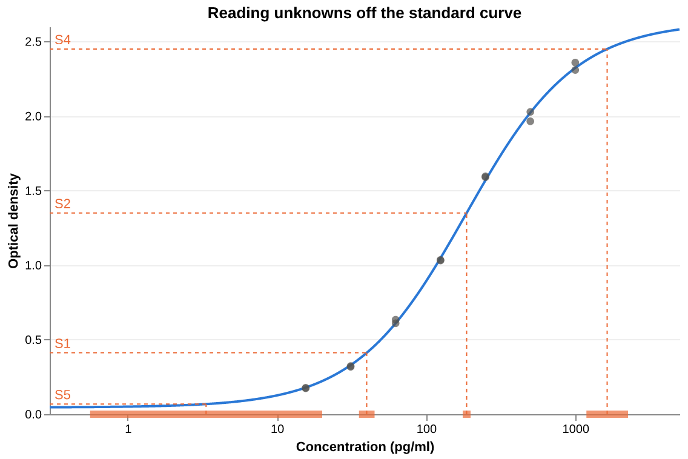
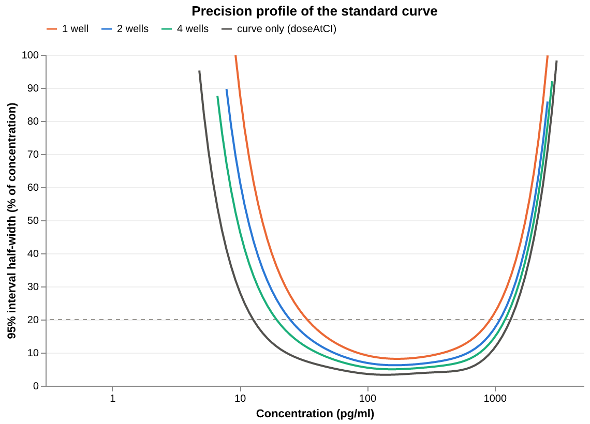

<!-- Generated by vignettes/knit.nim from vignettes/standard_curves.nim: edit that, not this. -->

# Standard curves and inverse prediction

Fit an ELISA standard curve, read the concentrations of unknown samples
off it with calibration intervals, check the standards' recovery, and map
the concentrations over which the assay is precise enough to report.

## The standards

Eight standards from 0 to 1000 pg/ml in a two-fold series, each in
duplicate wells, and their optical densities (OD):

```nim
import std/[math, sequtils, strformat]
import drc
import drcplot

let standards = [
  0.0, 0.0, 15.6, 15.6, 31.25, 31.25, 62.5, 62.5, 125.0, 125.0, 250.0, 250.0, 500.0,
  500.0, 1000.0, 1000.0,
]
let od = [
  0.05, 0.05, 0.177, 0.174, 0.323, 0.318, 0.61, 0.634, 1.035, 1.031, 1.596, 1.59, 2.028,
  1.965, 2.309, 2.359,
]
```

## Choosing the curve

ELISA standard curves are often asymmetric, which is why the 5PL is
popular for them. Fit both and let the data decide:

```nim
let four = fitLL4(standards, od)
let five = fitLL5(standards, od)
echo &"AIC: 4PL {four.aic:.2f}, 5PL {five.aic:.2f}"
let (aLo, aHi) = five.confint(Asymmetry)
echo &"5PL Asymmetry = {five.params[Asymmetry]:.2f} (95% CI {aLo:.2f} to {aHi:.2f})"
echo &"lack of fit, 4PL: p = {four.lackOfFit.p:.3f}"
echo ""
echo four.summary
```

```
AIC: 4PL -67.63, 5PL -66.56
5PL Asymmetry = 1.27 (95% CI 0.38 to 2.15)
lack of fit, 4PL: p = 0.172

4PL fit to 16 observations

              Estimate   Std.Error     Lower 95%     Upper 95%
Bottom       0.0452310   0.0154705     0.0115236     0.0789385
Top            2.63327   0.0459178       2.53323       2.73332
LogEC50        2.26599   0.0168594       2.22925       2.30272
Hill           1.17915   0.0401917       1.09158       1.26672
EC50           184.496                   169.532       200.780

Residual standard error: 0.0246964 on 12 degrees of freedom
R²: 0.999311   AIC: -67.6321   BIC: -63.7691
Stopped after 6 iterations: relative change in SSR below ftol
```

Here the 4PL has the lower AIC, the 5PL's Asymmetry interval contains 1
(a symmetric curve), and the lack-of-fit test finds nothing the 4PL
misses. These standards stop at 1000 pg/ml, before the top plateau, so
there is little to pin an asymmetry down with. The 4PL is the standard
curve from here on.

```nim
let curve = four
```

## Back-calculating the standards

A routine check on a standard curve is to read each standard back off it
as if it were an unknown. The recovery (back-calculated / nominal) should
be close to 100%, commonly within 80–120% (75–125% at the lowest
standard):

```nim
echo "nominal   OD     back-calculated   recovery"
for i, conc in standards:
  if conc > 0:
    let back = curve.doseAt(od[i])
    echo &"{conc:7.2f}  {od[i]:.3f}   {back:9.1f}         {100 * back / conc:5.1f}%"
```

```
nominal   OD     back-calculated   recovery
  15.60  0.177        15.4          99.0%
  15.60  0.174        15.1          96.9%
  31.25  0.323        30.6          97.9%
  31.25  0.318        30.1          96.3%
  62.50  0.610        62.5         100.0%
  62.50  0.634        65.4         104.7%
 125.00  1.035       122.9          98.3%
 125.00  1.031       122.2          97.8%
 250.00  1.596       259.5         103.8%
 250.00  1.590       257.4         102.9%
 500.00  2.028       504.7         100.9%
 500.00  1.965       451.5          90.3%
1000.00  2.309       958.7          95.9%
1000.00  2.359      1125.7         112.6%
```

Every standard passes. The worst is a well at 1000 pg/ml, at 113%: near
the top of the curve the OD changes little with concentration, so a small
error in OD becomes a large one in concentration.

The blanks are left out above. Their OD (0.050) is just above the fitted
Bottom (0.045), so they read back as a small positive concentration
rather than 0:

```nim
echo &"Bottom = {curve.params[Bottom]:.4f}; a blank reads as {curve.doseAt(0.05):.2f} pg/ml"
```

```
Bottom = 0.0452; a blank reads as 0.89 pg/ml
```

## Reading unknowns off the curve

Five samples, each measured in duplicate wells. `doseAt` gives the
concentration at the mean OD, and `calibrationCI` its 95% interval:
it combines the curve's own uncertainty with the scatter of the sample's
measurement, σ² / `replicates`. A dose outside the standards is an
extrapolation, so compare it with `logDoseRange` (log10 of the lowest and
highest non-zero standard). `doseAt` is NaN for an OD beyond the fitted
plateaus, where no concentration gives it.

```nim
let samples = [
  ("S1", [0.405, 0.419]),
  ("S2", [1.33, 1.37]),
  ("S3", [2.69, 2.73]),
  ("S4", [2.43, 2.47]),
  ("S5", [0.071, 0.065]),
]

proc mean(xs: openArray[float]): float =
  sum(xs) / float(xs.len)

echo "sample  mean OD  pg/ml    95% CI           note"
for (name, wells) in samples:
  let sampleOd = mean(wells)
  let conc = curve.doseAt(sampleOd)
  if conc.isNaN:
    echo &"{name:<6}  {sampleOd:.3f}       –                     beyond the top plateau: dilute and re-run"
    continue
  let ci = curve.calibrationCI(sampleOd, replicates = wells.len)
  let note =
    if log10(conc) > curve.logDoseRange.upper:
      "above the top standard"
    elif log10(conc) < curve.logDoseRange.lower:
      "below the lowest standard"
    else:
      ""
  echo &"{name:<6}  {sampleOd:.3f}  {conc:7.1f}  [{ci.lower:6.1f}, {ci.upper:6.1f}]  {note}"
```

```
sample  mean OD  pg/ml    95% CI           note
S1      0.412     40.1  [  35.5,   45.2]  
S2      1.350    187.1  [ 176.1,  198.8]  
S3      2.710       –                     beyond the top plateau: dilute and re-run
S4      2.450   1637.2  [1187.7, 2257.0]  above the top standard
S5      0.068      3.4  [   0.6,   20.1]  below the lowest standard
```

S1 and S2 sit well inside the standards. S3's OD is above the curve's top
plateau, so it has no concentration at all. S4 and S5 do have one, but
both are extrapolated, and their intervals show what that costs: S4's
runs from 1188 to 2257 pg/ml, and S5's from 0.6 to 20 pg/ml, a factor of
more than 30.

The figure shows each reading: across from the sample's OD to the curve,
then down to the concentration, with the calibration interval as a bar on
the dose axis.

```nim
let axis = doseAxis("Concentration (pg/ml)", 0.3, 5000.0)

proc readingFrames(
    name: string, sampleOd, conc: float, ci: ConfInt
): tuple[across, down, interval, label: DataFrame] =
  ## One sample's reading, in display units: the line across from the y axis
  ## to the curve, the line down to the x axis, the interval on the x axis,
  ## and the label at the start of the line across.
  let d = axis.toDisplay(conc)
  result.across =
    dataFrame(col("dose", @[axis.lo]), col("dose2", @[d]), col("response", @[sampleOd]))
  result.down =
    dataFrame(col("dose", @[d]), col("response", @[0.0]), col("response2", @[sampleOd]))
  result.interval = dataFrame(
    col("dose", @[axis.toDisplay(ci.lower)]),
    col("dose2", @[axis.toDisplay(ci.upper)]),
    col("response", @[0.0]),
  )
  result.label = dataFrame(
    col("dose", @[axis.lo]), col("response", @[sampleOd]), col("label", @[name])
  )

var layers = @[
  axis.curveLine(curve, "Optical density"),
  axis.dots(axis.observationFrame(standards, od)),
]
for (name, wells) in samples:
  let sampleOd = mean(wells)
  let conc = curve.doseAt(sampleOd)
  if conc.isNaN:
    continue
  let f =
    readingFrames(name, sampleOd, conc, curve.calibrationCI(sampleOd, replicates = 2))
  layers.add chart(f.across).markRule(color = orange, strokeDash = @[3.0, 3.0]).encode(
    x = axis.x, x2 = "dose2:Q", y = "response:Q"
  )
  layers.add chart(f.down).markRule(color = orange, strokeDash = @[3.0, 3.0]).encode(
    x = axis.x, y = "response:Q", y2 = "response2:Q"
  )
  layers.add chart(f.interval)
    .markRule(color = orange, strokeWidth = 6, opacity = 0.7)
    .encode(x = axis.x, x2 = "dose2:Q", y = "response:Q")
  layers.add chart(f.label)
    .markText(align = "left", dx = 4, dy = -7, color = orange, fontSize = 11)
    .encode(x = axis.x, y = "response:Q", text = "label:N")
layer(layers).finish("Reading unknowns off the standard curve").figure(
  "readings", "The 4PL standard curve with four samples read off it"
)
```



## Confidence or calibration interval?

`doseAtCI` answers a different question: where the concentration lies at
which the *mean* OD equals a given value. It has only the curve's
uncertainty, so it is the interval a sample would get from infinitely
many replicate wells. More wells move `calibrationCI` towards it, but
never past it:

```nim
let s2 = mean(samples[1][1])
for wells in [1, 2, 4, 8]:
  let ci = curve.calibrationCI(s2, replicates = wells)
  echo &"calibrationCI, {wells} well(s): [{ci.lower:.1f}, {ci.upper:.1f}]"
let meanOnly = curve.doseAtCI(s2)
echo &"doseAtCI:                   [{meanOnly.lower:.1f}, {meanOnly.upper:.1f}]"
```

```
calibrationCI, 1 well(s): [173.0, 202.4]
calibrationCI, 2 well(s): [176.1, 198.8]
calibrationCI, 4 well(s): [178.2, 196.5]
calibrationCI, 8 well(s): [179.4, 195.2]
doseAtCI:                   [180.8, 193.6]
```

## The working range

How precise a reading is depends on where it falls on the curve: on the
plateaus the OD barely moves with concentration. A precision profile
shows this, here as the half-width of the 95% calibration interval as a
percentage of the concentration (from the interval's geometric centre,
since it is symmetric on the log scale), across the range of the curve:

```nim
proc halfWidth(ci: ConfInt): float =
  ## The interval's half-width on the log scale, as a % of its centre.
  100 * (sqrt(ci.upper / ci.lower) - 1)

var conc, precision: seq[float]
var wells: seq[string]
for d in axis.doseGrid(120):
  let mid = curve.predict(d)
  for (label, ci) in [
    ("1 well", curve.calibrationCI(mid, replicates = 1)),
    ("2 wells", curve.calibrationCI(mid, replicates = 2)),
    ("4 wells", curve.calibrationCI(mid, replicates = 4)),
    ("curve only (doseAtCI)", curve.doseAtCI(mid)),
  ]:
    if ci.halfWidth <= 100:
      conc.add d
      precision.add ci.halfWidth
      wells.add label

let profileLabels = ["1 well", "2 wells", "4 wells", "curve only (doseAtCI)"]
layer(
  chart(dataFrame(col("response", @[20.0])))
    .markRule(color = muted, strokeDash = @[4.0, 4.0])
    .encode(y = "response:Q"),
  chart(dataFrame(col("dose", conc), col("response", precision), col("series", wells)))
    .markLine(strokeWidth = 2)
    .encode(
      x = axis.x,
      y = "response:Q".title("95% interval half-width (% of concentration)").scale(
          domain = vals(0.0, 100.0)
        ),
      color = seriesColors(profileLabels, [orange, blue, aqua, ink], legendAt = "top"),
    ),
)
  .finish("Precision profile of the standard curve")
  .figure(
    "precision", "Half-width of the 95% calibration interval against concentration"
  )
```



Taking a half-width of ±20% (the dashed line) as the limit, the working
range for duplicate wells is where the blue line is below it:

```nim
proc workingRange(replicates: int, limit = 20.0): (float, float) =
  ## The lowest and highest concentrations on the grid whose interval
  ## half-width is within `limit` %.
  result = (NaN, NaN)
  for d in axis.doseGrid(400):
    if curve.calibrationCI(curve.predict(d), replicates = replicates).halfWidth <= limit:
      if result[0].isNaN:
        result[0] = d
      result[1] = d

for n in [1, 2, 4]:
  let (lo, hi) = workingRange(n)
  echo &"{n} well(s): {round(lo).int} to {round(hi).int} pg/ml"
```

```
1 well(s): 34 to 908 pg/ml
2 well(s): 25 to 1077 pg/ml
4 well(s): 20 to 1188 pg/ml
```

With duplicates, the lowest standard (15.6 pg/ml) is below the working
range: the curve passes through it, but a sample there could not be
measured to ±20%. The upper end runs into the top plateau, so more wells
extend the range less there than at the lower end. Outside it, report a sample
as below or above the quantifiable range, or dilute it and re-run.

## Weighting

The duplicate wells agree more closely at low OD than at high OD (0.000
to 0.005 apart below 0.4, 0.024 to 0.063 above it). A common remedy is to
weight each observation by 1 / OD², i.e. assume a constant coefficient of
variation rather than a constant SD. Weights are relative, and a sample's
`weight` in `calibrationCI` must be on the same scale, so it is 1 / OD²
too. This is an illustration: with duplicates at eight standards, the
variance model rests on very little data.

```nim
let weights = curve.fitted.mapIt(1 / (it * it))
let weighted = fitLL4(standards, od, weights = weights)
echo "sample  unweighted              weighted (1/OD²)"
for (name, wells) in samples:
  let sampleOd = mean(wells)
  if curve.doseAt(sampleOd).isNaN:
    continue
  let u = curve.calibrationCI(sampleOd, replicates = 2)
  let w =
    weighted.calibrationCI(sampleOd, weight = 1 / (sampleOd * sampleOd), replicates = 2)
  echo &"{name:<6}  {curve.doseAt(sampleOd):6.1f} [{u.lower:6.1f}, {u.upper:6.1f}]   {weighted.doseAt(sampleOd):6.1f} [{w.lower:6.1f}, {w.upper:6.1f}]"
```

```
sample  unweighted              weighted (1/OD²)
S1        40.1 [  35.5,   45.2]     40.6 [  39.1,   42.2]
S2       187.1 [ 176.1,  198.8]    184.9 [ 173.8,  196.7]
S4      1637.2 [1187.7, 2257.0]   1868.2 [ 966.6, 3610.6]
S5         3.4 [   0.6,   20.1]      3.0 [   2.7,    3.5]
```

The weights come from the unweighted fit's fitted values rather than the
observed ODs, so that one noisy well does not weight itself. S1 and S2
barely move. The extrapolated samples change most: S4's estimate rises
to 1868 pg/ml and its interval widens to 967–3611, and S5's interval
shrinks from 0.6–20 pg/ml to 2.7–3.5. That last interval is only as
good as the assumption that the CV stays constant all the way down to
the blank, which the two blank
wells (both 0.050) cannot check. Weighting is a statement about the
assay's noise, so base it on more replicates than one plate provides.

## Next

- [Getting started](getting_started.md): fitting and checking a single
  curve.
- [Choosing a model](model_choice.md): 3PL, 4PL or 5PL, fixed plateaus
  and bounds.
- [Confidence intervals](intervals.md): Wald, profile-likelihood and
  bootstrap intervals.
- [Outliers](outliers.md): robust fits for wells that went wrong.
